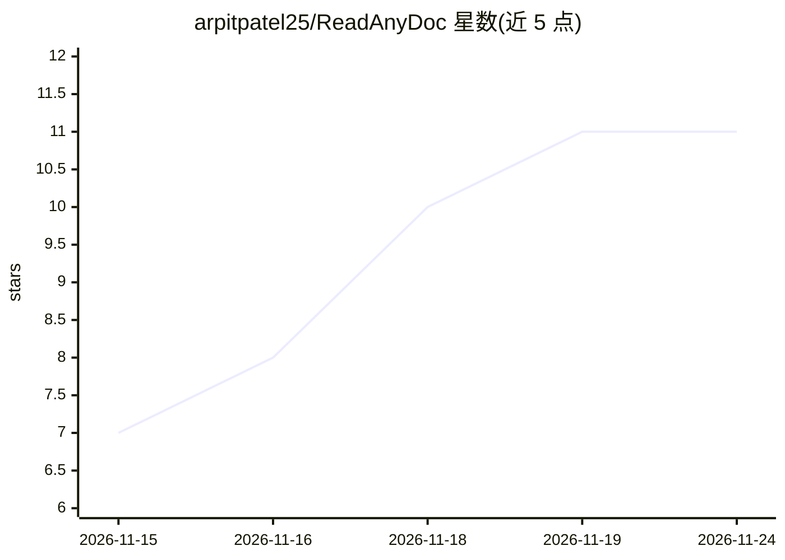

# arpitpatel25/ReadAnyDoc

⭐ 11 · Python · Apache-2.0 · 推送 2026-11-22 · [GitHub](https://github.com/arpitpatel25/ReadAnyDoc) · [官网](https://arpitpatel25.github.io/ReadAnyDoc/) · 个人维护

**开源文档解析库：PDF/扫描件转带引用的 Markdown 与结构化数据**

以视觉模型逐页读取 PDF、扫描件、照片或 Office 文件，返回带位置与逐词引用的类型化块、表格、Markdown 或按自定义 schema 抽取的字段；模型外层引擎提供版面块、表单字段、页眉页脚、表格校验与引用。以 Python 库、CLI 或兼容 Reducto HTTP API 的服务器形式提供，另有 MCP server 供 Claude Code/Cursor 等助手调用。提供 engine 与 model-only 两种模式，模型可选 Claude、OpenAI 或任意 OpenAI 兼容端点。README 说明速度慢于 Reducto（20-50 秒/页），拒绝页回退为普通 OCR。

## 筛选速览

| 维度 | 判定 | 备注 |
|---|---|---|
| AI 角色 | `ai-native` | 本体是模型或模型工具 |
| 许可风险 | `permissive` | Apache-2.0 |
| 部署形态 | `self-host` | docker 或自建部署 |
| 模型依赖 | locked-api |  |
| 硬件要求 | — | 无带数字的原话,不猜 |
| 安装摩擦 | `low` | 无编译、无系统依赖或容器化 |
| 成熟度 | — | 结构信号不足 |

## 能力要点

- 每个抽取值带页面位置引用，未按原样打印的是/否答案标记为低置信度
- 兼容 Reducto HTTP API，现有集成仅需改一个 URL
- 支持 pydantic/JSON Schema 定义抽取字段，提供 review 与 alternatives 可选项
- 提供 MCP server 与 LangChain/LlamaIndex 加载器集成

## 适用场景

- 把发票、贷款估算表等文档解析为带引用的 Markdown
- 按自定义 schema 从表单抽取字段并核验出处
- 在 Claude Code/Cursor 中通过 MCP 直接解析本地文件
- 用兼容 API 替换现有 Reducto 集成

## 场景标签

`文档解析` `OCR` · 领域:知识与检索

## 证据(README 行号)

> L8: ReadAnyDoc reads every page of a PDF, scan, photo or Office file with a vision model (Claude Haiku 5.5 by default)
> L11: form fields, headers and footers, table checks, word-level citations. It runs as a Python library or as a server
> L114: Models: any Claude model, OpenAI models (`gpt-...`), or any OpenAI-compatible endpoint written as

## 星数曲线

2026-11-15 7 → 2026-11-24 11（+4）

---
*卡片 v1 · prompt 1.4 · 生成 2026-11-19 · 置信度 high · 依据 README sha `5f5188057bd1` · [字段定义](../../DATASET.md)*
