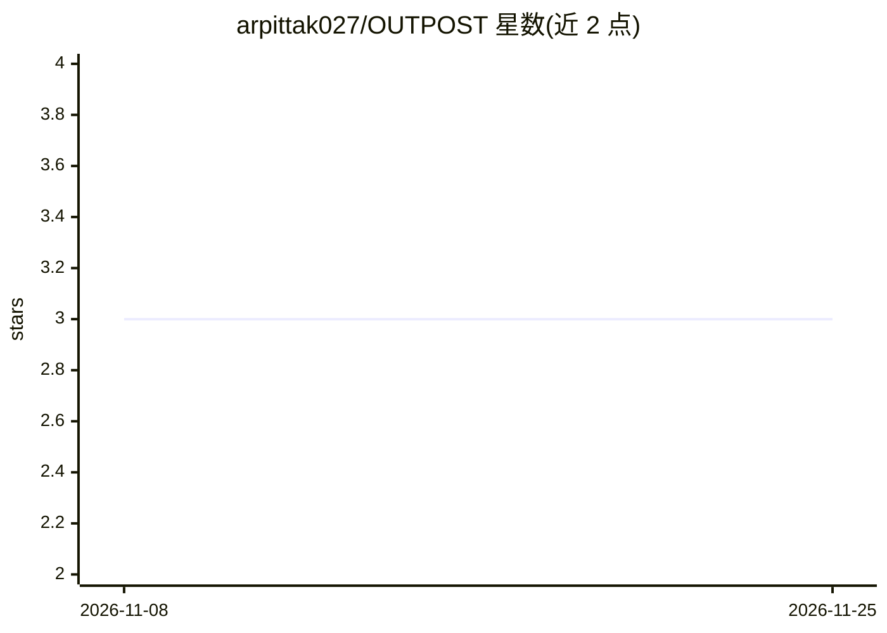

# arpittak027/OUTPOST

⭐ 3 · TypeScript · GPL-3.0 · 推送 2026-10-22 · [GitHub](https://github.com/arpittak027/OUTPOST) · [官网](https://outpost-arpit.netlify.app) · 个人维护

**给团队的 agentic AI 工作区：AI 实时写文档、画画布图**

基于 Next.js 的 agentic 协作工作区：AI agent 同时驱动两块实时界面——tldraw 无限画布上逐形状生成流程图、架构图与 ERD 表格，BlockNote 文档中起草技术规格与路线图，经 Yjs 与 Supabase Realtime 支持多人光标同步编辑。附带 Clerk 组织级多租户与角色权限、看板、只读分享链接与 PDF 导出、分级用量配额计费。部署需 Node.js 22+ 及 Clerk/Supabase/Google AI Studio 账号，从源码安装运行。

## 筛选速览

| 维度 | 判定 | 备注 |
|---|---|---|
| AI 角色 | `ai-native` | 本体是模型或模型工具 |
| 许可风险 | `viral` | GPL-3.0 |
| 部署形态 | `library` | 以包/库形式分发 |
| 模型依赖 | — | README 未给出锁定关系 |
| 硬件要求 | — | 无带数字的原话,不猜 |
| 安装摩擦 | `low` | 无编译、无系统依赖或容器化 |
| 成熟度 | — | 结构信号不足 |

## 能力要点

- 双界面 agent：同一请求在 tldraw 生成 ERD 并在 BlockNote 撰写文档
- 自定义 ERD 表形状支持 PK/FK 徽标与关系连线吸附
- Supabase Realtime + Yjs 实时多人协作
- 分级计划（Free/Pro/Team/Enterprise）用量配额与提示词月度跟踪

## 适用场景

- 让 AI 边画数据库 ERD 边写配套规格文档
- 团队多人实时协作的方案规划空间
- 按组织管理成员权限与工作区

## 场景标签

`AI 写作` · 领域:内容生成

## 证据(README 行号)

> L3: **An agentic AI workspace: chat with an AI agent that draws on a live whiteboard canvas and writes docs, while your 
> L19: **Outpost** is an agentic collaborative workspace that brings AI directly into the creative and technical planning 
> L41: |**AI Engine**|Vercel AI SDK with Google Gemini (`gemini-3.5-flash-lite`)|

## 星数曲线

2026-11-08 3 → 2026-11-25 3（+0）

---
*卡片 v1 · prompt 1.4 · 生成 2026-11-22 · 置信度 high · 依据 README sha `5bc5559be20f` · [字段定义](../../DATASET.md)*
