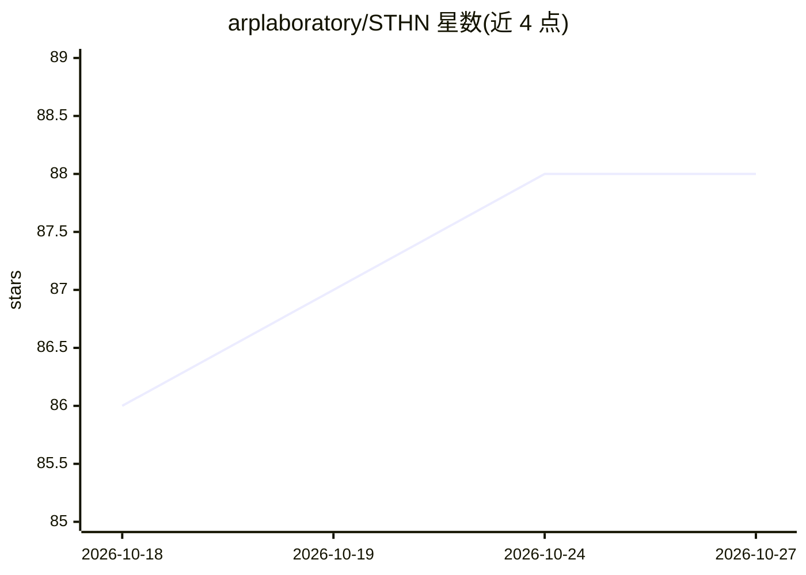

# arplaboratory/STHN

⭐ 88 · Jupyter Notebook · MIT · 推送 2026-05-16 · [GitHub](https://github.com/arplaboratory/STHN) · [官网](https://xjh19971.github.io/STHN/) · 组织维护

**无人机热成像对齐卫星图像的单应估计地理定位方法（RA-L 2024）**

RA-L 2024 论文 STHN 的官方代码库。提出基于深度单应估计的无人机热成像地理定位方法：通过单阶段或两阶段模型估计 UAV 热图像与卫星图像间的单应变换矩阵，实现定位；特征提取器由多层 CNN 残差块与组归一化构成，迭代更新模块求解变换，DLT 用于由四对对应点解 3x3 单应矩阵（采用 kornia 实现）。以 conda 环境提供，含推理 demo（自动从 Hugging Face 下载模型）、训练/评估脚本（面向 slurm sbatch）与 122 GB 扩展数据集。面向科研复现与遥感/无人机定位研究。

## 筛选速览

| 维度 | 判定 | 备注 |
|---|---|---|
| AI 角色 | `ai-native` | 本体是模型或模型工具 |
| 许可风险 | `permissive` | MIT |
| 部署形态 | `None` |  |
| 模型依赖 | — | README 未给出锁定关系 |
| 硬件要求 | — | 无带数字的原话,不猜 |
| 安装摩擦 | `low` | 无编译、无系统依赖或容器化 |
| 成熟度 | — | 结构信号不足 |

## 能力要点

- 单阶段/两阶段深度单应估计，实现 UAV 热图像与卫星图像对齐定位
- STHN_demo.py 一键推理，自动从 Hugging Face 下载模型
- 提供扩展 Boson-nighttime 数据集（122 GB，含 TGM 生成的热图像）
- 面向 slurm 的训练/评估脚本，含 coarse 对齐与 refinement 两阶段训练流程

## 适用场景

- 复现 RA-L 2024 论文的 UAV 热成像地理定位实验
- 在扩展数据集上训练/评估热-卫星图像单应估计模型
- 与 anyloc、STGL 等图像匹配基线做对比实验

## 场景标签

`科研工具` · 领域:学习与行业

## 证据(README 行号)

> L1: # STHN: Deep Homography Estimation for UAV Thermal Geo-localization with Satellite Imagery
> L8: This is the official repository for STHN: Deep Homography Estimation for UAV Thermal Geo-localization with Satellite
> L29: To quickly get started with STHN, we provide a `STHN_demo.py` script. This demo automatically downloads the model f

## 星数曲线

2026-10-18 86 → 2026-10-27 88（+2）

---
*卡片 v1 · prompt 1.4 · 生成 2026-10-24 · 置信度 high · 依据 README sha `550cdd404961` · [字段定义](../../DATASET.md)*
