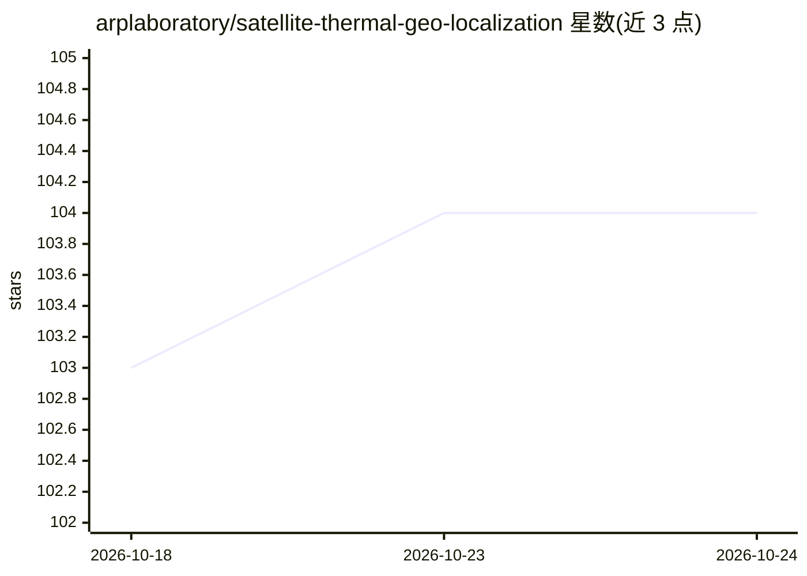

# arplaboratory/satellite-thermal-geo-localization

⭐ 104 · Python · MIT · 推送 2026-05-16 · [GitHub](https://github.com/arplaboratory/satellite-thermal-geo-localization) · [官网](https://xjh19971.github.io/STGL/) · 组织维护

**无人机热成像与卫星图像跨模态地理定位研究代码（IROS 2023）**

论文 Long-range UAV Thermal Geo-localization with Satellite Imagery 的官方实现，面向机器人/遥感方向研究者。包含 TGM（卫星→热成像生成，基于对比学习/pix2pix 风格框架）与 SGM（热成像→卫星图像检索定位，ResNet18 骨干、DANN 域对抗训练）两个模块，提供训练、评估脚本（slurm sbatch 为主）、数据集 md5 校验与 Hugging Face 预训练模型下载的推理 demo。README 注明预训练权重与当前代码可能不兼容，建议配合 STHN/global_pipeline 使用。

## 筛选速览

| 维度 | 判定 | 备注 |
|---|---|---|
| AI 角色 | `ai-native` | 本体是模型或模型工具 |
| 许可风险 | `permissive` | MIT |
| 部署形态 | `None` |  |
| 模型依赖 | — | README 未给出锁定关系 |
| 硬件要求 | — | 无带数字的原话,不猜 |
| 安装摩擦 | `low` | 无编译、无系统依赖或容器化 |
| 成熟度 | — | 结构信号不足 |

## 能力要点

- TGM 卫星→热成像生成 + SGM 检索定位的两阶段流水线
- demo 脚本自动从 Hugging Face 下载预训练模型并运行推理
- 提供数据集结构说明与 md5 校验值
- 评估输出 R@1/R@5 等检索指标

## 适用场景

- 复现论文中的无人机热成像地理定位实验
- 在自有的卫星-热成像配对数据上训练跨模态定位模型
- 下载预训练 TGM/SGM 模型做推理测试

## 场景标签

 · 领域:机器人/遥感定位

## 证据(README 行号)

> L9: This is the official repository for Long-range UAV Thermal Geo-localization with Satellite Imagery.
> L36: python TGM_demo.py  # Satellite -> Thermal generation (xjh19972/TGM)
> L37: python SGM_demo.py  # Thermal -> Satellite retrieval (xjh19972/SGM)

## 星数曲线

2026-10-18 103 → 2026-10-24 104（+1）

---
*卡片 v1 · prompt 1.4 · 生成 2026-10-23 · 置信度 high · 依据 README sha `413531c3aee9` · [字段定义](../../DATASET.md)*
