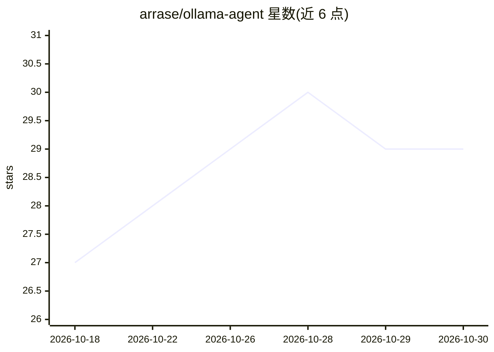

# arrase/ollama-agent

⭐ 29 · Python · MIT · 推送 2026-10-27 · [GitHub](https://github.com/arrase/ollama-agent) · [官网](https://arrase.github.io/ollama-agent/) · 个人维护 · 中文 README

**本地优先的通用 AI agent CLI/REPL，经 Ollama 运行本地模型**

基于 Ollama 原生 API 的命令行 agent：提供 CLI 与 Textual/Rich 构建的交互式 REPL，通过可编辑的 Jinja2 系统提示模板把 agent 定义为通用助手而非仅编码助手。直接读取 GGUF 元数据动态设置 num_ctx、按 Modelfile 自动发现采样参数、按服务器指标精确计数 token，85% 容量时自动压缩上下文。支持 HITL/YOLO/Stealth 模式、@文件注入、MEMORY.md 持久记忆、本地 Qdrant RAG、MCP 外部工具与专用子 agent。需 Python 3.11+ 与本地 Ollama 及工具调用模型。

## 筛选速览

| 维度 | 判定 | 备注 |
|---|---|---|
| AI 角色 | `ai-native` | 本体是模型或模型工具 |
| 许可风险 | `permissive` | MIT |
| 部署形态 | `library` | 以包/库形式分发 |
| 模型依赖 | local-ok | 支持本地模型 |
| 硬件要求 | — | 无带数字的原话,不猜 |
| 安装摩擦 | `low` | 无编译、无系统依赖或容器化 |
| 成熟度 | — | 结构信号不足 |

## 能力要点

- 直连 Ollama 原生 API：动态 num_ctx、Modelfile 采样参数自动发现、精确 token 计数
- 85% 容量自动上下文压缩（摘要旧轮次、修剪工具输出、历史落盘）
- 本地 RAG（Qdrant + Ollama embeddings）、MCP 扩展与专用子 agent
- 可编辑系统提示模板 + 15 种内置界面语言

## 适用场景

- 在本地机器上跑一个可自定义行为的通用 AI 助手
- 通过 @-mention 注入文件做文档分析或日志排查
- 用本地模型搭建带本地知识库（RAG）的个人问答助手

## 场景标签

`AI 助手` `RAG` · 领域:对话与助手

## 证据(README 行号)

> L30: **Ollama Agent** is an autonomous, local-first AI assistant that runs entirely on your hardware through Ollama. It'
> L65: Most agents treat Ollama as a dumb OpenAI-compatible proxy. They send requests to `/v1/chat/completions`, cross the

## 星数曲线

2026-10-18 27 → 2026-10-30 29（+2）

---
*卡片 v1 · prompt 1.4 · 生成 2026-10-26 · 置信度 high · 依据 README sha `b03d1b65291d` · [字段定义](../../DATASET.md)*
