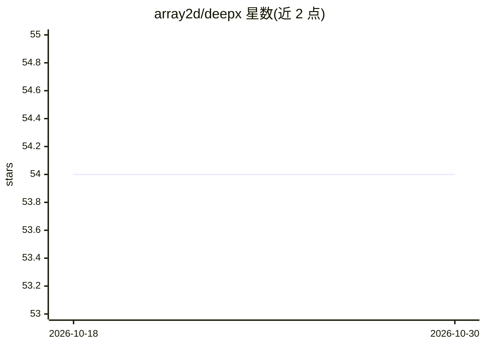

# array2d/deepx

⭐ 54 · C++ · Apache-2.0 · 推送 2026-07-17 · [GitHub](https://github.com/array2d/deepx) · [官网](https://deepx.array2d.com/) · 组织维护 · 中文 README

**分布式深度学习训练/推理统一框架，存算控解耦架构**

deepx 是以'统一存算面'为底座的深度学习计算框架，面向算法工程师提供接近 pytorch/numpy 风格的模型表达 API，将模型表达为计算图 IR 交给统一存算面执行；面向 infra 工程师提供 SDK 可实现自定义调度器与执行器。统一存算面基于 redis kv 寻址空间组织分布式 GPU 集群的 tensor 与计算图，调度层支持多轮 IR 等价编译替换、算子融合、数据/流水线/模型并行，后端有 heap-cuda 与 op-cuda 执行器（NVIDIA 平台）。提供官方文档与商业支持联系方式，采用 Apache License 2.0。README 未给出安装命令。

## 筛选速览

| 维度 | 判定 | 备注 |
|---|---|---|
| AI 角色 | `ai-ecosystem` | LLM/agent 周边工具 |
| 许可风险 | `permissive` | Apache-2.0 |
| 部署形态 | `None` |  |
| 模型依赖 | — | README 未给出锁定关系 |
| 硬件要求 | — | 无带数字的原话,不猜 |
| 安装摩擦 | `medium` | 含编译或系统依赖之一 |
| 成熟度 | — | 结构信号不足 |

## 能力要点

- 前端输出计算图 IR，统一存算面作为分布式 tensor 计算解释器执行
- 基于 redis kv 统一寻址空间组织分散 GPU 算力与 tensor
- 调度层支持 IR 编译替换、算子融合与数据/流水线/模型并行
- SDK 允许实现自定义调度器与执行器（如 dataloader 执行器）

## 适用场景

- 以接近数学的表达方式编写模型并自动获得分布式执行
- 在 GPU 集群上组织 tensor 存储与并行计算
- infra 工程师按存算协议扩展自定义调度器/执行器

## 场景标签

`模型训练` `推理引擎` · 领域:训练与推理

## 证据(README 行号)

> L4: deepx一种以统一存算面为底座的深度学习计算框架,模型函数可以通过简单的数学形式进行表达为计算图，计算图可以写入到统一存算面的存储空间，被统一存算面的调度执行器自动执行，你也可以按照统一存算面的协议，实现自己的执行器，例如data
> L28: 统一存算面可以被看作一个原生的分布式tensor计算解释器。
> L39:  + 执行器层：绑定具体的加速硬件，实现真正的tensor的储存、计算、网络通信，大规模并行化。

## 星数曲线

2026-10-18 54 → 2026-10-30 54（+0）

---
*卡片 v1 · prompt 1.4 · 生成 2026-10-24 · 置信度 high · 依据 README sha `30da21b27fda` · [字段定义](../../DATASET.md)*
