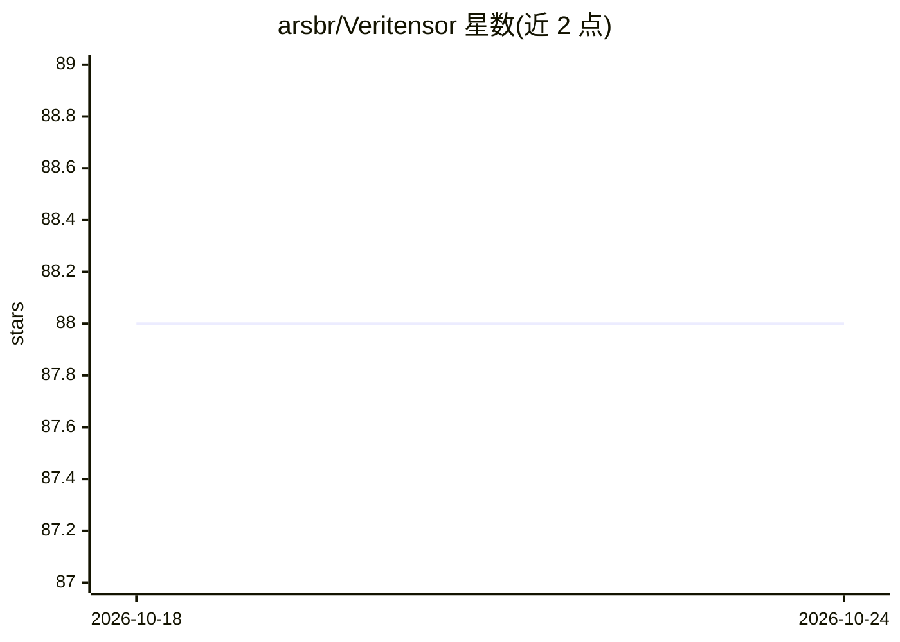

# arsbr/Veritensor

⭐ 88 · Python · Apache-2.0 · 推送 2026-08-04 · [GitHub](https://github.com/arsbr/Veritensor) · [官网](https://www.veritensor.com) · 个人维护

**AI 供应链安全扫描器：静态扫描模型、数据集、RAG 文档与笔记本**

面向 AI 工程与安全团队的静态分析 CLI 与 Python 库：对 Pickle/PyTorch/Keras/Safetensors 模型做 AST 分析检测 RCE 与后门，流式扫描 Parquet/CSV/PDF 等检测数据投毒、PII 与提示注入，审计依赖 Typosquatting 与 CVE，检测 MCP 服务器 Agent 劫持风险。提供 LangChain/LlamaIndex/ChromaDB 集成作为 RAG 防火墙，支持 Sigstore 签名、SARIF/AI-BOM/Excel/HTML 等报告格式及 EU AI Act 合规报告，可接入 GitHub Actions、Pre-commit、GitLab CI。核心安装约 50MB，按模块安装可选组件。

## 筛选速览

| 维度 | 判定 | 备注 |
|---|---|---|
| AI 角色 | `ai-ecosystem` | LLM/agent 周边工具 |
| 许可风险 | `permissive` | Apache-2.0 |
| 部署形态 | `desktop` | 安装包/桌面程序 |
| 模型依赖 | — | README 未给出锁定关系 |
| 硬件要求 | — | 无带数字的原话,不猜 |
| 安装摩擦 | `low` | 无编译、无系统依赖或容器化 |
| 成熟度 | — | 结构信号不足 |

## 能力要点

- 模型文件（Pickle/PyTorch/Keras/Safetensors）AST 分析检测 RCE 与后门
- RAG 文档与数据集的提示注入、数据投毒、PII 流式扫描（100GB+）
- MCP 服务器 Python 文件与配置文件的 Agent 劫持风险检测
- 输出 SARIF/CycloneDX AI-BOM/Excel/HTML 及 EU AI Act 合规报告

## 适用场景

- 在 CI/CD 流水线中拦截恶意模型与被投毒的数据集
- RAG 数据入库前清洗提示注入与 PII 内容
- 生成 EU AI Act 合规差距报告与 AI-BOM 清单
- 审计 MCP 服务器配置的越权风险

## 场景标签

`网络安全` `MLOps` · 领域:学习与行业

## 证据(README 行号)

> L11: **Veritensor** is the Anti-Virus for AI Artifacts and the ultimate Firewall for RAG pipelines. It secures the entir
> L13: Veritensor shift security left. Instead of waiting for a prompt injection to hit your LLM, Veritensor intercepts an
> L25: * **Native RAG Security:** Embed Veritensor directly into `LangChain`, `LlamaIndex`, `ChromaDB`, and `Unstructured.

## 星数曲线

2026-10-18 88 → 2026-10-24 88（+0）

---
*卡片 v1 · prompt 1.4 · 生成 2026-10-23 · 置信度 high · 依据 README sha `59639b709839` · [字段定义](../../DATASET.md)*
