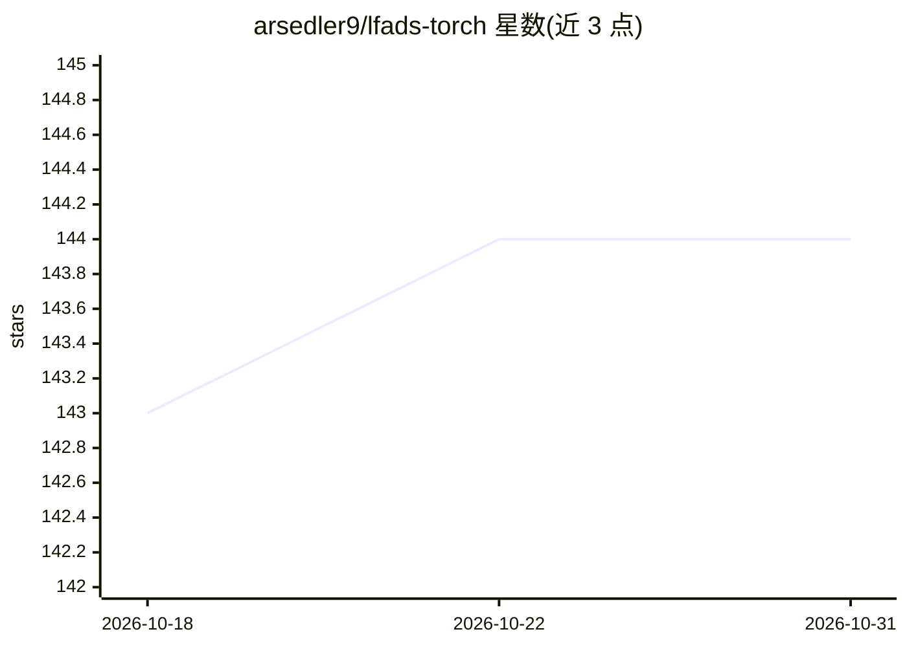

# arsedler9/lfads-torch

⭐ 144 · Jupyter Notebook · NOASSERTION · 推送 2026-03-30 · [GitHub](https://github.com/arsedler9/lfads-torch) · [官网](https://arxiv.org/abs/2309.01230) · 个人维护

**面向神经科学的 LFADS/AutoLFADS PyTorch 实现：训练与分析神经潜变量动态模型**

用 PyTorch 与 PyTorch Lightning 重新实现 LFADS（变分序列自编码器），用于对高维神经脉冲等时间序列数据降噪并推断潜在动态。提供单/多会话训练流程：HDF5 数据输入、Hydra 可组合配置、随机搜索与种群训练（PBT）超参优化脚本。重构损失（Poisson/Gaussian/Gamma/ZIG）、数据增强与先验均可通过配置替换。面向神经科学研究者，附 arXiv 预印本与 Neural Latents Benchmark 示例数据，训练依赖 GPU（如有）。

## 筛选速览

| 维度 | 判定 | 备注 |
|---|---|---|
| AI 角色 | `ai-native` | 本体是模型或模型工具 |
| 许可风险 | `none` | NOASSERTION |
| 部署形态 | `library` | 以包/库形式分发 |
| 模型依赖 | — | README 未给出锁定关系 |
| 硬件要求 | — | 无带数字的原话,不猜 |
| 安装摩擦 | `low` | 无编译、无系统依赖或容器化 |
| 成熟度 | — | 结构信号不足 |

## 能力要点

- 基于 PyTorch/Lightning/Hydra 的模块化 LFADS 实现
- 支持单会话与多会话（PCR 初始化）训练
- Poisson/Gaussian/Gamma/零膨胀 Gamma 可切换重构损失与可扩展的增强栈/先验
- 提供随机搜索与种群训练（PBT）超参扫描脚本

## 适用场景

- 对神经脉冲、EMG、钙成像数据训练 LFADS 模型去噪与推断潜在动态
- 复现或扩展 AutoLFADS 大规模超参优化流程
- 参与 Neural Latents Benchmark 评测

## 场景标签

`模型训练` · 领域:训练与推理

## 证据(README 行号)

> L8: Latent factor analysis via dynamical systems (LFADS) is a variational sequential autoencoder that achieves state-of-

## 星数曲线

2026-10-18 143 → 2026-10-31 144（+1）

---
*卡片 v1 · prompt 1.4 · 生成 2026-10-22 · 置信度 mid · 依据 README sha `5a4c9bc30515` · [字段定义](../../DATASET.md)*
