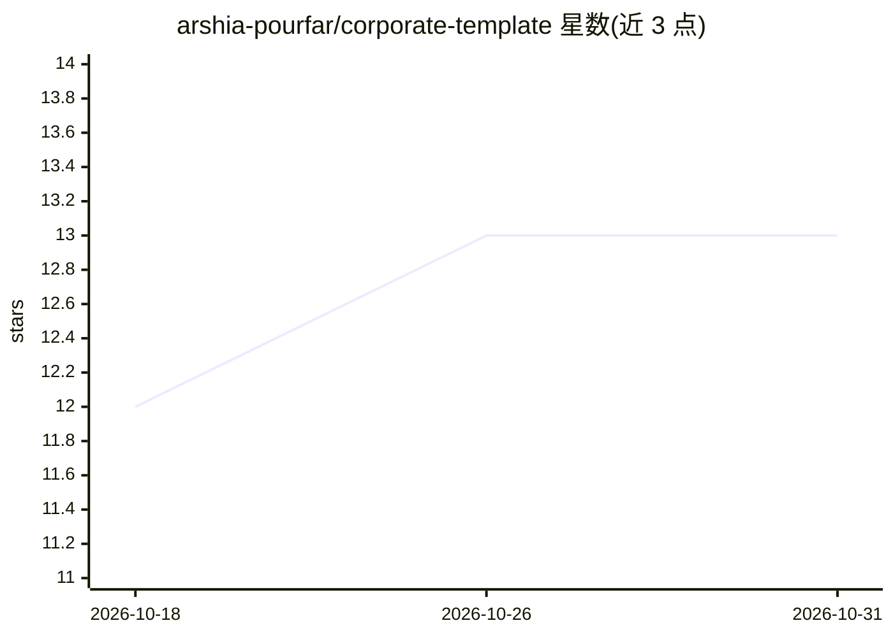

# arshia-pourfar/corporate-template

⭐ 13 · TypeScript · 推送 2026-02-01 · [GitHub](https://github.com/arshia-pourfar/corporate-template) · [官网](https://corporate-template-arshia-pourfar.vercel.app) · 个人维护

**面向企业的 Next.js 企业官网/落地页模板**

基于 Next.js 与 TypeScript、Tailwind CSS 的纯前端企业官网模板，无后端依赖。提供响应式布局（桌面/平板/手机）、可复用组件、平滑动画与常见企业站点分区（服务、作品集、团队、联系方式）。安装方式为 git clone 仓库后本地运行，面向需要快速搭建企业展示站点的开发者和初创团队。README 未展示任何 AI 相关功能，虽然仓库标签含 ai，但正文无对应实现或说明。

## 筛选速览

| 维度 | 判定 | 备注 |
|---|---|---|
| AI 角色 | `ai-enhanced` | 去掉 AI 部分产品仍成立 |
| 许可风险 | `none` | — |
| 部署形态 | `None` |  |
| 模型依赖 | — | README 未给出锁定关系 |
| 硬件要求 | — | 无带数字的原话,不猜 |
| 安装摩擦 | `low` | 无编译、无系统依赖或容器化 |
| 成熟度 | — | 结构信号不足 |

## 能力要点

- 纯前端实现，无后端依赖
- 桌面/平板/手机响应式布局
- 模块化可复用组件与平滑动画
- 基于 Next.js + Tailwind CSS + TypeScript

## 适用场景

- 为初创公司或代理机构搭建企业展示站点
- 作为落地页/作品集/团队介绍的起步模板
- 学习 Next.js 企业站点项目结构

## 场景标签

 · 领域:Web 前端/网站模板

## 证据(README 行号)

> L3: A clean, professional **corporate landing page template**, optimized for performance and modern UI/UX.
> L20: - **Next.js** – Frontend framework

## 星数曲线

2026-10-18 12 → 2026-10-31 13（+1）

---
*卡片 v1 · prompt 1.4 · 生成 2026-10-31 · 置信度 low · 依据 README sha `cd95b20a4be2` · [字段定义](../../DATASET.md)*
