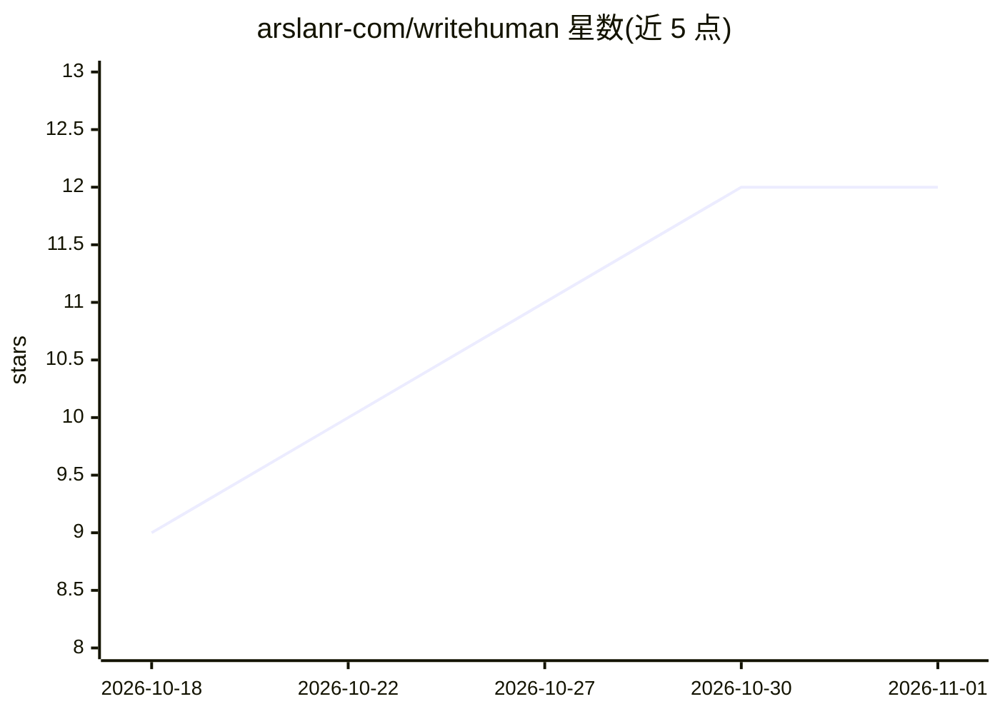

# arslanr-com/writehuman

⭐ 12 · Python · MIT · 推送 2026-10-15 · [GitHub](https://github.com/arslanr-com/writehuman) · 个人维护

**统计式文本检测工具：标出读起来像 LLM 输出的词句并给出偏离程度**

writehuman 是一个 Node.js CLI，附带供编码 agent 使用的 Agent Skill。它将文本与 2022-11-30 之前人类写作的约 28 亿词元语料及 11 个模型家族的文本做统计对比，标记 LLM 使用频率远高于人类的词、短语、句式、排版习惯与文档风格特征，给出倍率（如 42x）、全文评分与 human-like/borderline/llm-like 判定；另有 diff 命令核对改写中丢失或新增的数字、路径等事实。完全离线运行，不调用模型、无需 API key。评分以人类基准文本分位数设定阈值（英文 101.7/133.2），主要面向英文，附带若干欧洲语言包。

## 筛选速览

| 维度 | 判定 | 备注 |
|---|---|---|
| AI 角色 | `ai-ecosystem` | LLM/agent 周边工具 |
| 许可风险 | `permissive` | MIT |
| 部署形态 | `library` | 以包/库形式分发 |
| 模型依赖 | — | README 未给出锁定关系 |
| 硬件要求 | — | 无带数字的原话,不猜 |
| 安装摩擦 | `low` | 无编译、无系统依赖或容器化 |
| 成熟度 | — | 结构信号不足 |

## 能力要点

- 对照 2022 年前约 28 亿词元人类语料与 11 个模型家族，输出逐条倍率标记
- 全文评分与 human-like/borderline/llm-like 判定，阈值取自人类基准文本分位数
- diff 命令检查改写后丢失或新增的事实（数字、路径、URL 等）
- Agent Skill 可让编码 agent 自动改写并循环复查，完全离线无需 API key

## 适用场景

- 我写完文档后想找出哪些句子读起来像 AI 写的并逐处修改
- 让编码 agent 生成文本后自动跑检查、改写并复查直到达标
- 在 CI 或 pre-commit 钩子中用退出码拦截 AI 味过重的文本

## 场景标签

`AI 写作` · 领域:内容生成

## 证据(README 行号)

> L3: writehuman tells you which parts of a text sound machine-made and how far off they are. Your coding agent can use it
> L59: Then ask for it in plain words. "Check this draft with writehuman" will do, or "make this sound more human". Before
> L129: AI detectors (GPTZero, Originality.ai, Binoculars and others) estimate how likely it is that a machine wrote the t

## 星数曲线

2026-10-18 9 → 2026-11-01 12（+3）

---
*卡片 v1 · prompt 1.4 · 生成 2026-11-01 · 置信度 mid · 依据 README sha `14ce52db565c` · [字段定义](../../DATASET.md)*
