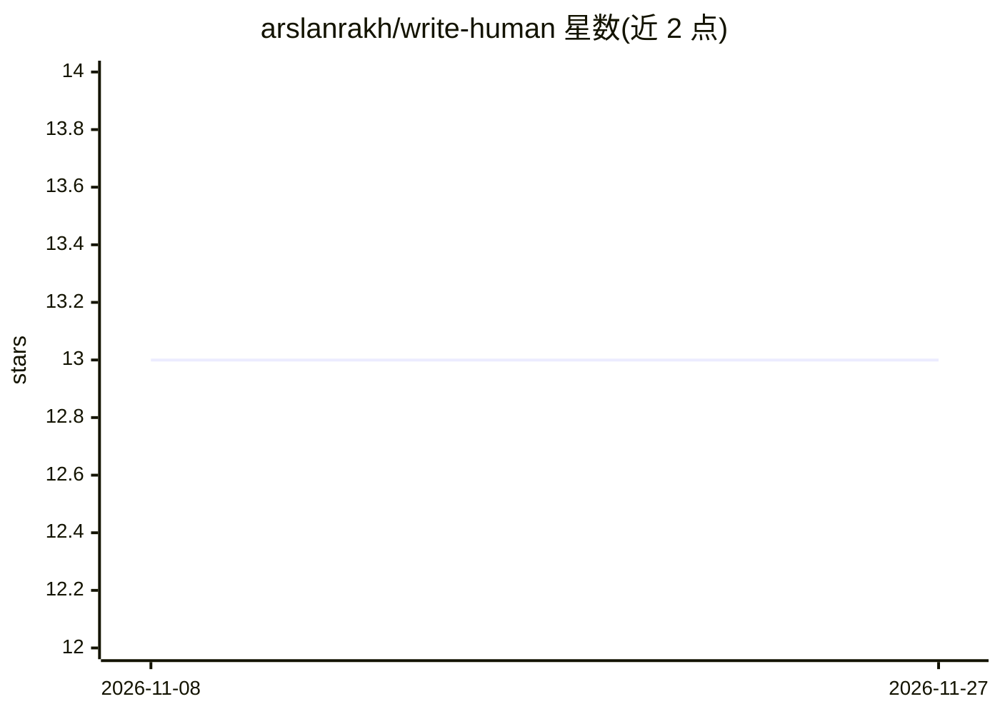

# arslanrakh/write-human

⭐ 13 · Python · MIT · 推送 2026-11-05 · [GitHub](https://github.com/arslanrakh/write-human) · [官网](https://www.npmjs.com/package/writehuman) · 个人维护

**离线 linter：标记文本中 LLM 风味语句并给出比值分数**

writehuman 以 CLI 与 Agent Skill 形式提供，检测文本中机器味浓的词、短语、句式与文档风格：统计模型基于 2022 年前 2.8B tokens 人类语料与 11 个模型家族预计算，运行时不调用任何模型、无需 API key、完全离线。输出逐条标记（如“LLM 文本中高频 42 倍”）、整篇分数与 human-like/llm-like 判定，另提供 diff 命令比对改写前后丢失的事实（数字/路径/URL）。分发于 npm，可经 skills CLI 接入 Claude Code、Codex、Cursor 等代理。

## 筛选速览

| 维度 | 判定 | 备注 |
|---|---|---|
| AI 角色 | `ai-native` | 本体是模型或模型工具 |
| 许可风险 | `permissive` | MIT |
| 部署形态 | `library` | 以包/库形式分发 |
| 模型依赖 | — | README 未给出锁定关系 |
| 硬件要求 | — | 无带数字的原话,不猜 |
| 安装摩擦 | `low` | 无编译、无系统依赖或容器化 |
| 成熟度 | — | 结构信号不足 |

## 能力要点

- 基于 2.8B tokens 人类语料与 11 个 LLM 家族预计算的统计语言包
- 运行时零模型调用、零 API key，文本不离开本机
- check 输出逐条标记与比值、整篇分数及 human-like/llm-like 判定
- diff 命令比对改写前后丢失/新增的事实，退出码可用于 CI 与 pre-commit

## 适用场景

- 让编码代理改写文档后反复检查直至达到 human-like 判定
- 在 CI 或 pre-commit 钩子中以退出码拦截机器味文本
- 核对改写版本是否丢失原文中的数字、路径、URL 等事实
- 生成 text/json/html 格式的检测报告供脚本或人工查看

## 场景标签

 · 领域:开发工具/文本质量检测

## 证据(README 行号)

> L3: writehuman tells you which parts of a text sound machine-made and how far off they are. Your coding agent can use it
> L9: It runs offline. Nothing calls a model or needs an API key, and your text stays on your machine.
> L109: Each language has a pack of statistics computed in advance. The CLI checks five kinds of things against it.

## 星数曲线

2026-11-08 13 → 2026-11-27 13（+0）

---
*卡片 v1 · prompt 1.4 · 生成 2026-11-18 · 置信度 mid · 依据 README sha `bffa9e445236` · [字段定义](../../DATASET.md)*
