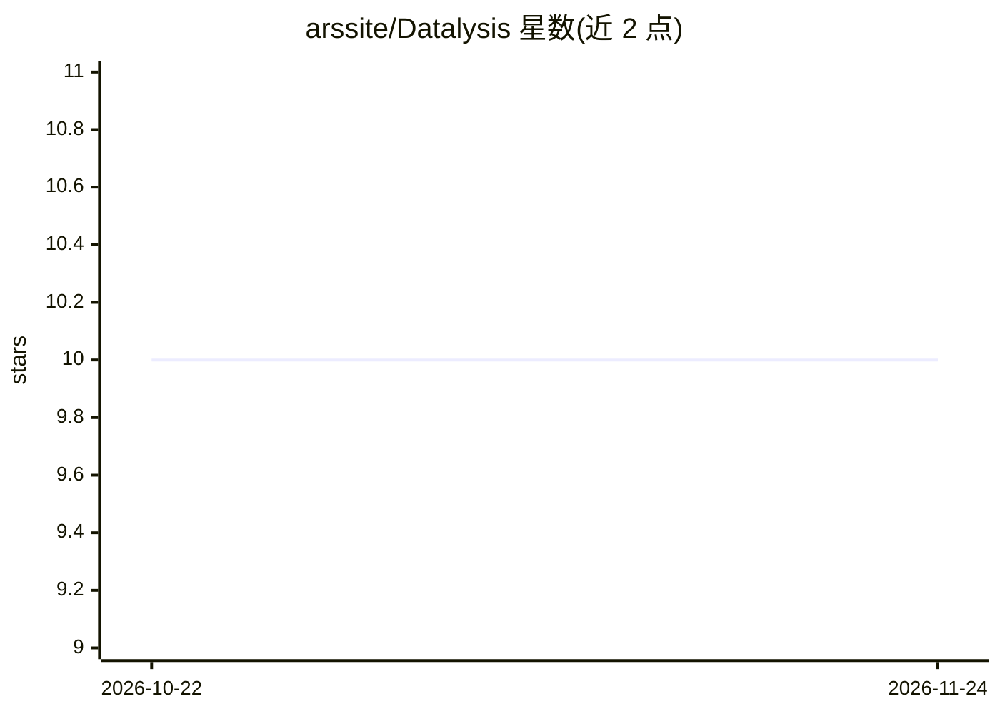

# arssite/Datalysis

⭐ 10 · Jupyter Notebook · 推送 2026-01-17 · [GitHub](https://github.com/arssite/Datalysis) · 个人维护

**深度学习算法内容与代码合集仓库**

该仓库收录深度学习与机器学习相关的算法内容，主题标签覆盖人工神经网络、CNN、RNN（LSTM/GRU）、自编码器，以及 LeNet、VGG16 等网络和情感分析、识别等任务方向。README 仅列出内容主题，未说明安装方式、运行方法或目标使用者；具体形式需查看仓库代码方可确认。

## 筛选速览

| 维度 | 判定 | 备注 |
|---|---|---|
| AI 角色 | `ai-knowledge` | 知识聚合/清单类 |
| 许可风险 | `none` | — |
| 部署形态 | `None` |  |
| 模型依赖 | — | README 未给出锁定关系 |
| 硬件要求 | — | 无带数字的原话,不猜 |
| 安装摩擦 | `low` | 无编译、无系统依赖或容器化 |
| 成熟度 | — | 结构信号不足 |

## 能力要点

- 覆盖 ANN/CNN/RNN(LSTM-GRU)/自编码器等深度学习主题
- 包含 LeNet、VGG16 等网络实现相关内容
- 涉及情感分析与识别任务方向

## 适用场景

- 查找常见深度学习网络结构的实现示例
- 学习 CNN、RNN、自编码器等算法内容

## 场景标签

`教程课程` · 领域:学习与行业

## 证据(README 行号)

> L1: # Machinearning
> L2: $ DEEP LEARNING

## 星数曲线

2026-10-22 10 → 2026-11-24 10（+0）

---
*卡片 v1 · prompt 1.4 · 生成 2026-11-20 · 置信度 low · 依据 README sha `7a34a2f00da1` · [字段定义](../../DATASET.md)*
