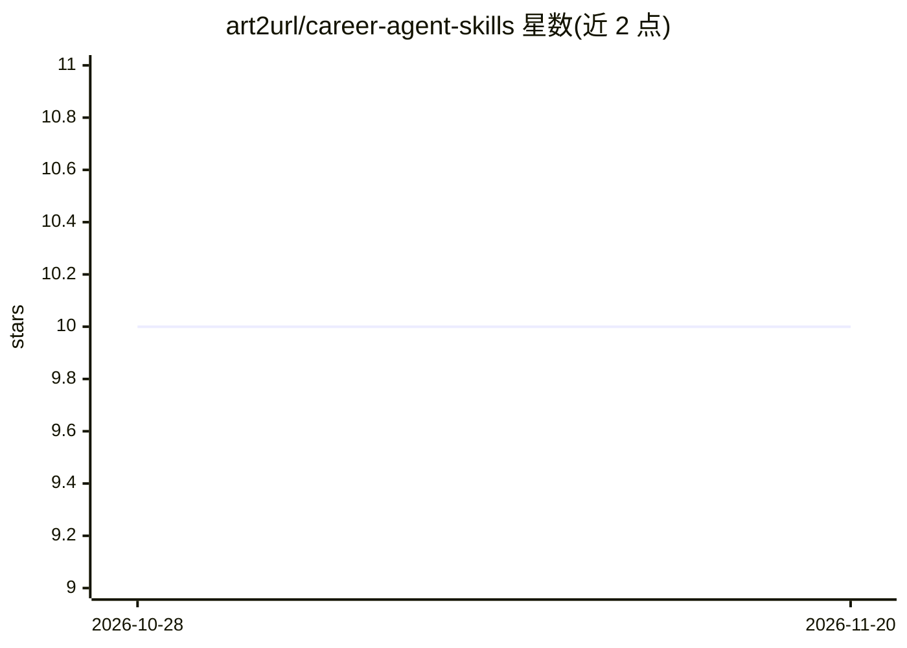

# art2url/career-agent-skills

⭐ 10 · MIT · 推送 2026-04-07 · [GitHub](https://github.com/art2url/career-agent-skills) · 个人维护

**给求职者的 AI agent 技能集：简历/面试/薪资谈判**

面向求职与职业发展的 agent 技能集合，包含 12 个技能：ATS 兼容检查、简历定制、岗位匹配分析、求职信撰写、LinkedIn 优化、模拟面试、薪酬谈判、转行规划及软件工程师/高管/学术 CV 等细分模板。每个技能为 agent 提供特定任务的可执行指令。通过 npx skills 命令或手动复制到 agent 的 skills 目录安装，兼容 Claude Code、Cursor、Windsurf、Codex、Gemini CLI、OpenCode 等 30+ agent。MIT 许可。

## 筛选速览

| 维度 | 判定 | 备注 |
|---|---|---|
| AI 角色 | `ai-knowledge` | 知识聚合/清单类 |
| 许可风险 | `permissive` | MIT |
| 部署形态 | `library` | 以包/库形式分发 |
| 模型依赖 | — | README 未给出锁定关系 |
| 硬件要求 | — | 无带数字的原话,不猜 |
| 安装摩擦 | `low` | 无编译、无系统依赖或容器化 |
| 成熟度 | — | 结构信号不足 |

## 能力要点

- 12 个职业技能：ATS 检查、简历定制、岗位匹配、求职信、模拟面试、薪酬谈判等
- 按简历构建/求职/面试谈判/职业发展四类组织
- npx skills add 一条命令全局安装
- 兼容 Claude Code、Cursor、Windsurf、Codex、Gemini CLI、OpenCode 等 30+ agent

## 适用场景

- 投递前检查并修复简历的 ATS 兼容性问题
- 针对具体岗位定制简历并评估匹配度与技能差距
- 通过模拟面试练习 STAR 行为面试回答
- 拿到 offer 后做薪酬对比与谈判邮件撰写

## 场景标签

`提示工程` `AI 写作` · 领域:Agent 开发

## 证据(README 行号)

> L3: AI agentic skills for resume building, job search strategy, and career development. Works with Claude Code, Cursor, 
> L5: Each skill gives your AI agent actionable instructions for specific career tasks — from ATS checks to compensation n

## 星数曲线

2026-10-28 10 → 2026-11-20 10（+0）

---
*卡片 v1 · prompt 1.4 · 生成 2026-11-20 · 置信度 high · 依据 README sha `e0f06f50e753` · [字段定义](../../DATASET.md)*
