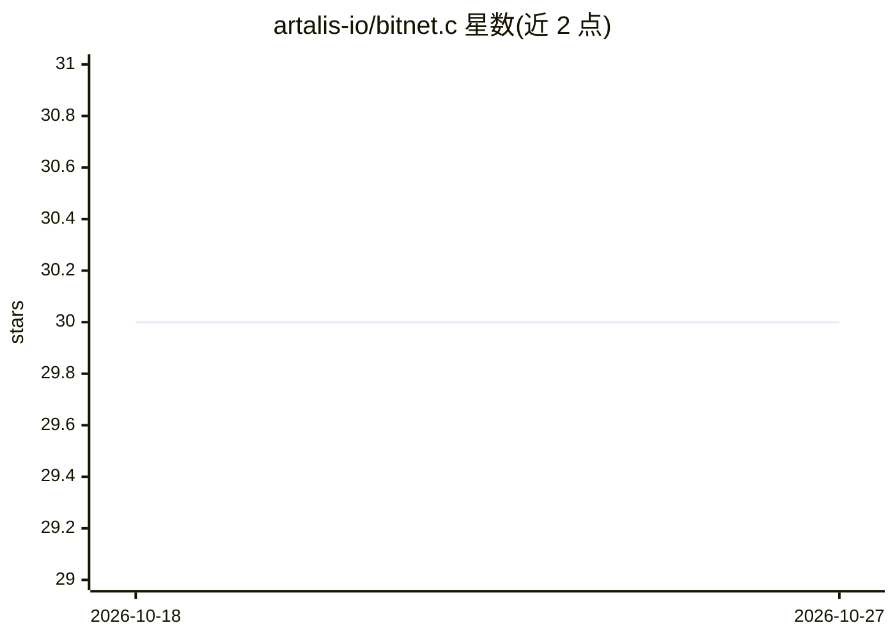

# artalis-io/bitnet.c

⭐ 30 · C · MIT · 推送 2026-09-19 · [GitHub](https://github.com/artalis-io/bitnet.c) · 组织维护

**纯 C11 的 GGUF LLM CPU 推理引擎，零依赖**

以 C11 编写的 GGUF LLM 推理引擎，模块拆分为模型解剖、量化内核、CPU 执行、GPU op 发射等单元。支持 20 余种量化格式与 ARM NEON/SDOT、x86 AVX2/AVX512 BW/VNNI、WASM SIMD 内核，另提供 Metal 与 wgpu-native WebGPU 可选后端。MoE 支持 mmap/pread/专家 LRU 缓存路由，KV 缓存可选 FP16 与 TurboQuant 压缩，支持投机解码与 WASM 目标。CUDA 尚未实现。面向需要嵌入或本地运行 GGUF 模型的开发者。

## 筛选速览

| 维度 | 判定 | 备注 |
|---|---|---|
| AI 角色 | `ai-ecosystem` | LLM/agent 周边工具 |
| 许可风险 | `permissive` | MIT |
| 部署形态 | `None` |  |
| 模型依赖 | — | README 未给出锁定关系 |
| 硬件要求 | — | 无带数字的原话,不猜 |
| 安装摩擦 | `medium` | 含编译或系统依赖之一 |
| 成熟度 | `idea` | |

## 能力要点

- 加载 dense/MoE/混合 SSM-attention 家族的 GGUF v3 模型（Qwen、BitNet、Llama、Gemma 等）
- MoE 专家路由含 pread 流式加载与 LRU 专家缓存
- TurboQuant KV 压缩与 FP16 KV 缓存、投机解码
- 可编译到 WASM，带 Metal/WebGPU 可选后端与 CPU 回退

## 适用场景

- 在纯 CPU 环境本地运行量化 GGUF 模型
- 以库形式嵌入宿主程序做多会话推理
- 通过 WASM 在浏览器/受限环境运行模型
- CPU MoE 推理场景下控制内存占用

## 场景标签

`推理引擎` · 领域:训练与推理

## 证据(README 行号)

> L3: Small C11 inference engine for GGUF LLMs, with a bias toward readable module
> L20: - MoE expert routing with mmap, pread, and expert LRU cache modes.

## 星数曲线

2026-10-18 30 → 2026-10-27 30（+0）

---
*卡片 v1 · prompt 1.4 · 生成 2026-10-26 · 置信度 high · 依据 README sha `1fb60d7611b5` · [字段定义](../../DATASET.md)*
