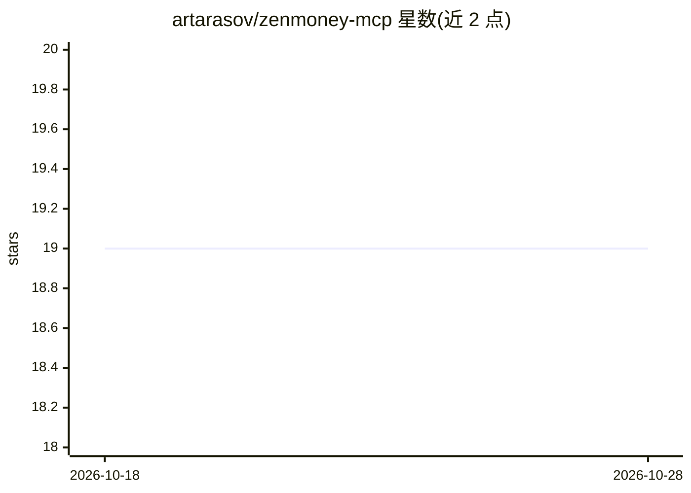

# artarasov/zenmoney-mcp

⭐ 19 · TypeScript · MIT · 推送 2026-09-04 · [GitHub](https://github.com/artarasov/zenmoney-mcp) · 个人维护

**ZenMoney 个人理财 MCP 服务器，供 Claude 等客户端操作账目**

连接 ZenMoney 个人理财服务的 MCP server：向 MCP 兼容的 AI 客户端（Claude Desktop、Cursor、Claude Code）暴露 11 个工具，覆盖数据同步、账户/分类/商户/交易查询，以及添加收支、跨币种转账、修改与批量重分类交易、按收款方推荐分类等写操作。使用需 Node.js 18+、ZenMoney 账号及 zerro.app 签发的 API token；支持 npx 免克隆接入、MCPB 一键安装包（token 存 OS 钥匙串）或源码构建。

## 筛选速览

| 维度 | 判定 | 备注 |
|---|---|---|
| AI 角色 | `ai-ecosystem` | LLM/agent 周边工具 |
| 许可风险 | `permissive` | MIT |
| 部署形态 | `library` | 以包/库形式分发 |
| 模型依赖 | — | README 未给出锁定关系 |
| 硬件要求 | — | 无带数字的原话,不猜 |
| 安装摩擦 | `low` | 无编译、无系统依赖或容器化 |
| 成熟度 | — | 结构信号不足 |

## 能力要点

- 11 个工具：同步、查询账户/分类/商户/交易
- 写操作：添加收支、跨币种转账、按 id 批量修改交易
- suggest_category 按收款方自动推荐分类
- 支持 npx 免克隆接入与 MCPB 一键安装包（token 存钥匙串）

## 适用场景

- 在 Claude/Cursor 中用自然语言查询自己的收支与账户
- 让 AI 客户端代为记账、转账并修正错误分类
- 按日期、类别筛选近期交易明细

## 场景标签

 · 领域:个人理财/AI 客具集成

## 证据(README 行号)

> L3: MCP server for ZenMoney — access your personal finance data from any MCP-compatible AI client (Claude Desktop, Curso
> L30: ### Claude Desktop

## 星数曲线

2026-10-18 19 → 2026-10-28 19（+0）

---
*卡片 v1 · prompt 1.4 · 生成 2026-10-28 · 置信度 high · 依据 README sha `6b1df215f909` · [字段定义](../../DATASET.md)*
