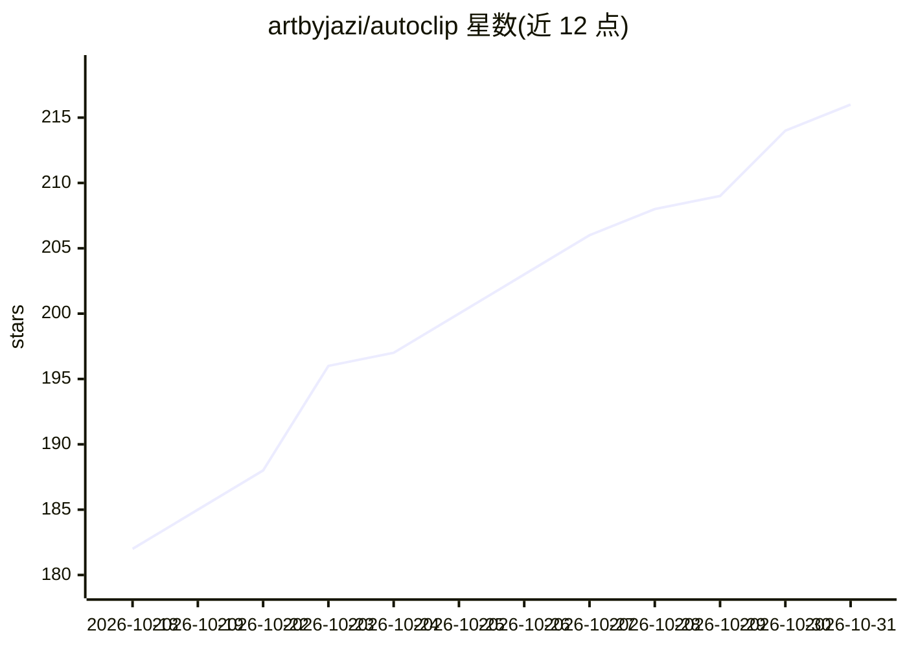

# artbyjazi/autoclip

⭐ 216 · Python · MIT · 推送 2026-08-01 · [GitHub](https://github.com/artbyjazi/autoclip) · 个人维护

**本地优先的开源 AI 视频剪辑器：长视频转竖屏短视频**

面向创作者的本地优先 AI 剪辑工具：输入 YouTube 链接或本地文件，经转录（Whisper）、LLM 高光检测、说话人跟踪重构图、动态字幕烧录，导出平台就绪的 9:16 等三种画幅 MP4。支持全离线（Whisper+Ollama）或自带 API key（Anthropic/OpenAI/Gemini 及 OpenAI 兼容端点）。提供 Web UI 与 CLI，Docker 镜像可选；需 Python 3.11/3.12 与完整版 ffmpeg（含 libass）。作者声明 Pre-1.0，重构图质量尚未对固定金标集验证。

## 筛选速览

| 维度 | 判定 | 备注 |
|---|---|---|
| AI 角色 | `ai-native` | 本体是模型或模型工具 |
| 许可风险 | `permissive` | MIT |
| 部署形态 | `self-host` | docker 或自建部署 |
| 模型依赖 | local-ok | 支持本地模型 |
| 硬件要求 | — | 无带数字的原话,不猜 |
| 安装摩擦 | `low` | 无编译、无系统依赖或容器化 |
| 成熟度 | `idea` | |

## 能力要点

- Whisper 转录 + LLM 高光检测 + 说话人跟踪重构图的完整流水线
- 全离线模式（Whisper + Ollama），仅发送转录文本或不外发任何数据
- 四种字幕样式、三种画幅导出，API key 存入系统钥匙串
- 分阶段断点续跑（各阶段产物落盘，失败重试从断点恢复）

## 适用场景

- 把长视频/播客自动切成带字幕的竖屏短视频
- 不想上传视频到云端或付订阅费时离线处理素材
- 多人对话视频中自动跟拍当前说话人

## 场景标签

`图像视频处理` · 领域:感知与多模态

## 证据(README 行号)

> L9: Paste a YouTube link or drop a file. AutoClip transcribes it, uses an LLM to find the moments worth clipping, refram
> L19: - **Fully local** — Whisper + Ollama. Nothing leaves your machine, no API costs.
> L26: Working end to end: ingest, transcription, highlight detection across four providers, speaker-tracked reframing, fo

## 星数曲线

2026-10-18 182 → 2026-10-31 216（+34）

---
*卡片 v1 · prompt 1.4 · 生成 2026-10-22 · 置信度 mid · 依据 README sha `0ebb0acb19e1` · [字段定义](../../DATASET.md)*
