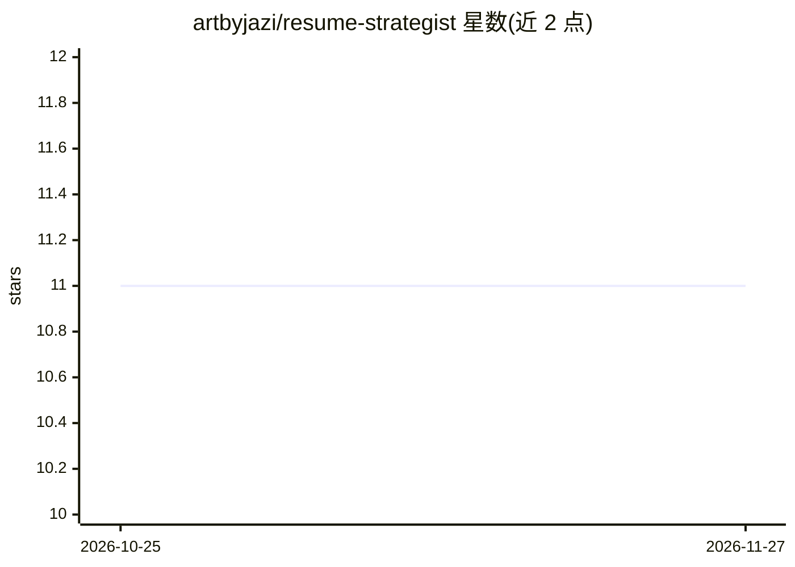

# artbyjazi/resume-strategist

⭐ 11 · Python · MIT · 推送 2026-08-22 · [GitHub](https://github.com/artbyjazi/resume-strategist) · 个人维护

**面向学生与应届求职者的开源简历/求职信提示词技能**

以单个指令文件（SKILL.md/PROMPT.md）形式分发的简历策略技能，可在 claude.ai、Claude Code、ChatGPT、Gemini、Ollama 本地模型等任意 LLM 中运行；流程含需求收集、策略提问、职位描述解析、生成一页定制简历与求职信、反 AI 痕迹检查与六轴质量评分；每条规则引用招聘研究来源（references/evidence.md）。限制：不含简历编辑器界面，需用户自备 LLM 会话；拒绝虚构指标与经历。

## 筛选速览

| 维度 | 判定 | 备注 |
|---|---|---|
| AI 角色 | `ai-native` | 本体是模型或模型工具 |
| 许可风险 | `permissive` | MIT |
| 部署形态 | `None` |  |
| 模型依赖 | local-ok | 支持本地模型 |
| 硬件要求 | — | 无带数字的原话,不猜 |
| 安装摩擦 | `low` | 无编译、无系统依赖或容器化 |
| 成熟度 | — | 结构信号不足 |

## 能力要点

- 模型无关：同一提示词可在 Claude/ChatGPT/Gemini/本地模型使用
- 流程化输出：策略提问→职位解析→定制简历→求职信→质量评分
- 规则附证据来源（references/evidence.md），MIT 许可

## 适用场景

- 求职时根据职位描述定制一份一页简历
- 为具体岗位生成对应格式的求职信
- 用本地模型在离线环境下生成简历初稿

## 场景标签

`提示工程` `AI 写作` · 领域:Agent 开发

## 证据(README 行号)

> L5: An open-source, model-agnostic "resume strategist" skill for students and early-career candidates. It does what an $
> L19: **Ollama / local models** — use `PROMPT.md` as the system prompt.

## 星数曲线

2026-10-25 11 → 2026-11-27 11（+0）

---
*卡片 v1 · prompt 1.4 · 生成 2026-11-18 · 置信度 high · 依据 README sha `bab639e56535` · [字段定义](../../DATASET.md)*
