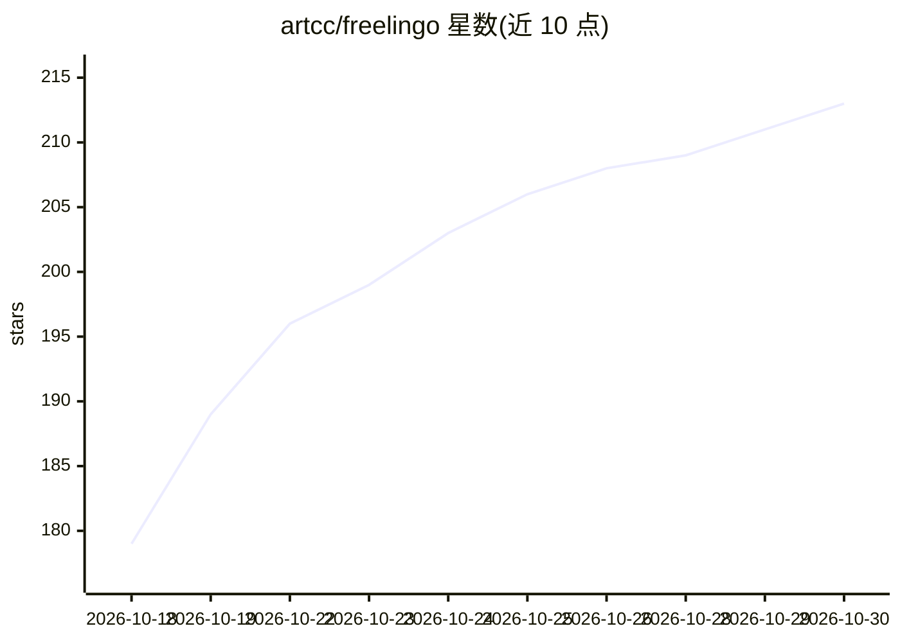

# artcc/freelingo

⭐ 213 · JavaScript · AGPL-3.0 · 推送 2026-10-29 · [GitHub](https://github.com/artcc/freelingo) · [官网](https://www.arturocarreterocalvo.com/freelingo) · 个人维护

**自托管/托管的 AI 语言学习平台：CEFR 课程与 AI 导师**

开源语言学习平台，以自托管（AGPL-3.0，Docker Compose 部署）与托管服务两种模式提供。LLM 评估用户 CEFR 等级（A1-C2），生成 4-16 周个性化学习路线，依次解锁语法、词汇、阅读、写作课程；配套 SM-2 间隔重复闪卡、AI 生成的听力/阅读练习、语音对话导师 Lingu 与发音练习。后端 FastAPI 代理全部 LLM/TTS/STT 调用，LLM 可选 Ollama/OpenAI/Anthropic/DeepSeek；本地语音服务默认需 NVIDIA GPU，实时语音对话在生产环境要求反向代理与 HTTPS。另提供商业许可。

## 筛选速览

| 维度 | 判定 | 备注 |
|---|---|---|
| AI 角色 | `ai-native` | 本体是模型或模型工具 |
| 许可风险 | `dual` | AGPL-3.0 |
| 部署形态 | `self-host` | docker 或自建部署 |
| 模型依赖 | local-ok | 支持本地模型 |
| 硬件要求 | — | 无带数字的原话,不猜 |
| 安装摩擦 | `low` | 无编译、无系统依赖或容器化 |
| 成熟度 | — | 结构信号不足 |

## 能力要点

- CEFR 对齐课程（A1-C2）与 LLM 定级、周计划生成
- 语音对话导师 Lingu 与用户可控持久记忆
- SM-2 间隔重复闪卡与 AI 生成听力/阅读练习
- LLM/TTS/STT 提供商均可本地（Ollama/Kokoro/faster-whisper）或云端切换

## 适用场景

- 自托管部署一个可控数据的语言学习平台
- 按 CEFR 等级获得结构化课程与 AI 导师辅导
- 机构私有化部署或定制白标版本（商业许可）

## 场景标签

 · 领域:教育/语言学习

## 证据(README 行号)

> L12: Open source AI language learning platform available in two modes: self-hosted (free, run it on your own
> L14: A language model evaluates your CEFR level, generates a personalized study plan, and guides you through
> L15: grammar, vocabulary, reading comprehension, writing lessons, AI-generated listening and reading exercises, and voic

## 星数曲线

2026-10-18 179 → 2026-10-30 213（+34）

---
*卡片 v1 · prompt 1.4 · 生成 2026-10-22 · 置信度 high · 依据 README sha `41b10bfa8f14` · [字段定义](../../DATASET.md)*
