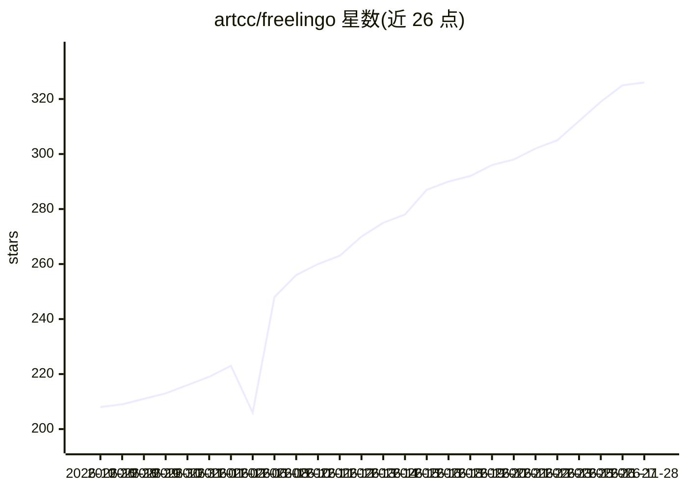

# artcc/freelingo

⭐ 326 · Python · AGPL-3.0 · 推送 2026-11-27 · [GitHub](https://github.com/artcc/freelingo) · [官网](https://www.arturocarreterocalvo.com/freelingo) · 组织维护

**自托管 AI 语言学习平台：A1–C2 课纲+语音 AI 导师**

开源、可自托管的语言学习平台，含结构化 A1–C2 课程与 AI 导师 Lingu。机制上：自适应分级测验与学习计划排期为确定性逻辑，课时内容由 LLM 在课纲边界内生成；支持文本与语音对话辅导、SM-2 间隔重复闪卡、50 个语音情景角色扮演与游戏化练习。架构为 Next.js 前端 + FastAPI 后端 + PostgreSQL/Redis，Docker Compose 部署；语音本地方案需 NVIDIA GPU。AGPL-3.0 许可，另有商业许可与托管云服务。

## 筛选速览

| 维度 | 判定 | 备注 |
|---|---|---|
| AI 角色 | `ai-native` | 本体是模型或模型工具 |
| 许可风险 | `dual` | AGPL-3.0 |
| 部署形态 | `self-host` | docker 或自建部署 |
| 模型依赖 | local-ok | 支持本地模型 |
| 硬件要求 | — | 无带数字的原话,不猜 |
| 安装摩擦 | `low` | 无编译、无系统依赖或容器化 |
| 成熟度 | — | 结构信号不足 |

## 能力要点

- 20 种学习语言的 A1–C2 课纲、分级测验与学习计划（4/8/12/16 周）
- 语音对话 AI 导师 Lingu，支持用户可控记忆与课时内练习
- SM-2 间隔重复闪卡、50 个语音情景角色扮演与学习游戏
- LLM 支持 Ollama/OpenAI/Anthropic/DeepSeek，TTS/STT 支持本地或云端

## 适用场景

- 在自己的服务器上自托管一套多语言学习平台
- 用 AI 导师做语音口语对话练习
- 按 CEFR 等级生成学习计划并配合闪卡复习

## 场景标签

`语音 Agent` · 领域:对话与助手

## 证据(README 行号)

> L18: FreeLingo is an open-source language learning platform with a structured A1–C2 curriculum and an AI
> L27: 3. **Practise with Lingu.** Use text and voice tutoring with user-controlled memories. Completed
> L112: - **LLM:** Ollama, OpenAI, Anthropic, or DeepSeek

## 星数曲线

2026-10-26 208 → 2026-11-28 326（+118）

---
*卡片 v1 · prompt 1.4 · 生成 2026-11-28 · 置信度 high · 依据 README sha `0c9a6124018d` · [字段定义](../../DATASET.md)*
