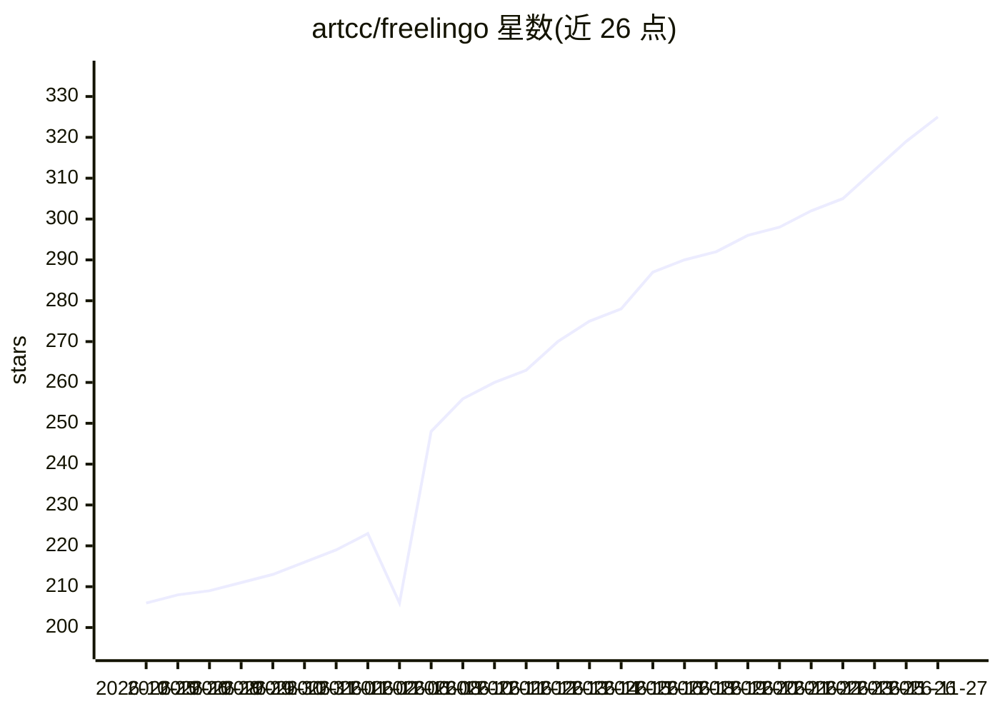

# artcc/freelingo

⭐ 325 · Python · AGPL-3.0 · 推送 2026-11-25 · [GitHub](https://github.com/artcc/freelingo) · [官网](https://www.arturocarreterocalvo.com/freelingo) · 个人维护

**开源自学托管语言学习平台，内置 AI 语音导师 Lingu**

以 Next.js 前端加 FastAPI 后端的单体仓库构建，通过 Docker Compose 部署，数据层使用 PostgreSQL 16 与 Redis 7。平台提供 A1–C2 结构化课程、自适应分级测试、按 4/8/12/16 周生成的学习计划、AI 生成的课程内容、文本与语音对话导师 Lingu、SM-2 间隔重复闪卡、50 种语音情景角色扮演和学习游戏，覆盖 20 种学习语言。LLM 支持 Ollama、OpenAI、Anthropic 或 DeepSeek；语音支持本地 Kokoro TTS 与 faster-whisper STT 或云服务，本地语音容器需 NVIDIA GPU。AGPL-3.0 自托管免费，另有云托管服务与商业许可。

## 筛选速览

| 维度 | 判定 | 备注 |
|---|---|---|
| AI 角色 | `ai-native` | 本体是模型或模型工具 |
| 许可风险 | `dual` | AGPL-3.0 |
| 部署形态 | `self-host` | docker 或自建部署 |
| 模型依赖 | local-ok | 支持本地模型 |
| 硬件要求 | — | 无带数字的原话,不猜 |
| 安装摩擦 | `low` | 无编译、无系统依赖或容器化 |
| 成熟度 | — | 结构信号不足 |

## 能力要点

- 文本与语音对话导师 Lingu，支持用户可控记忆
- A1–C2 课程、自适应分级测试与 4/8/12/16 周学习计划
- SM-2 闪卡间隔重复与 50 种语音情景角色扮演
- LLM 可选 Ollama/OpenAI/Anthropic/DeepSeek，语音支持本地或云端

## 适用场景

- 自托管一套按 CEFR 等级规划的语言学习课程并跟随计划学习
- 用语音与 AI 导师练习日常情景对话（旅行、购物、工作等）
- 用闪卡和间隔重复复习生词与语法
- 同时学习多门语言并分别跟踪进度

## 场景标签

`语音 Agent` · 领域:对话与助手

## 证据(README 行号)

> L18: FreeLingo is an open-source language learning platform with a structured A1–C2 curriculum and an AI
> L27: 3. **Practise with Lingu.** Use text and voice tutoring with user-controlled memories. Completed
> L109: - **LLM:** Ollama, OpenAI, Anthropic, or DeepSeek

## 星数曲线

2026-10-25 206 → 2026-11-27 325（+119）

---
*卡片 v1 · prompt 1.4 · 生成 2026-11-26 · 置信度 high · 依据 README sha `79287ab558bb` · [字段定义](../../DATASET.md)*
