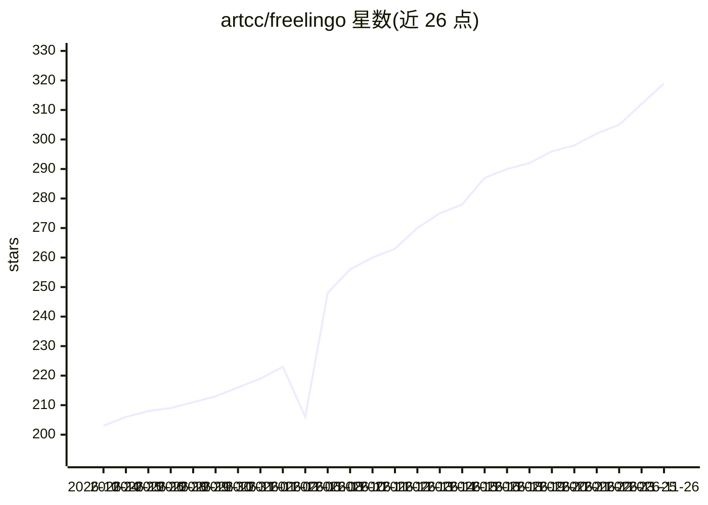

# artcc/freelingo

⭐ 319 · Python · AGPL-3.0 · 推送 2026-11-25 · [GitHub](https://github.com/artcc/freelingo) · [官网](https://www.arturocarreterocalvo.com/freelingo) · 组织维护

**自托管 AI 语言学习平台：结构化课程+语音 AI 导师**

开源语言学习平台，提供 A1–C2 结构化课程、自适应分级测试与按语言/级别/时长（4/8/12/16 周）生成的学习计划。核心功能包括名为 Lingu 的文本与语音 AI 导师（用户可控记忆）、SM-2 间隔重复闪卡、50 种日常情景语音角色扮演、学习游戏与进度看板，支持 20 种学习语言。架构为 Next.js 前端 + FastAPI 后端，Docker Compose 部署，存储用 PostgreSQL 16 与 Redis 7。LLM 支持 Ollama、OpenAI、Anthropic、DeepSeek；TTS/STT 支持本地与云服务。托管服务另有商业许可。

## 筛选速览

| 维度 | 判定 | 备注 |
|---|---|---|
| AI 角色 | `ai-native` | 本体是模型或模型工具 |
| 许可风险 | `dual` | AGPL-3.0 |
| 部署形态 | `self-host` | docker 或自建部署 |
| 模型依赖 | local-ok | 支持本地模型 |
| 硬件要求 | — | 无带数字的原话,不猜 |
| 安装摩擦 | `low` | 无编译、无系统依赖或容器化 |
| 成熟度 | — | 结构信号不足 |

## 能力要点

- A1–C2 课程与自适应分级测试，计划周期可选 4/8/12/16 周
- Lingu 语音/文本 AI 导师与 50 种情景角色扮演
- SM-2 间隔重复闪卡与学习游戏
- LLM 可选本地 Ollama 或 OpenAI/Anthropic/DeepSeek

## 适用场景

- 自托管一个结构化的多语言学习平台
- 用 AI 语音导师和情景角色扮演练口语
- 用闪卡和间隔重复复习词汇与语法

## 场景标签

`语音合成` `语音 Agent` · 领域:对话与助手

## 证据(README 行号)

> L18: FreeLingo is an open-source language learning platform with a structured A1–C2 curriculum and an AI
> L27: 3. **Practise with Lingu.** Use text and voice tutoring with user-controlled memories. Completed
> L109: - **LLM:** Ollama, OpenAI, Anthropic, or DeepSeek

## 星数曲线

2026-10-24 203 → 2026-11-26 319（+116）

---
*卡片 v1 · prompt 1.4 · 生成 2026-11-25 · 置信度 high · 依据 README sha `3c83c39df1bb` · [字段定义](../../DATASET.md)*
