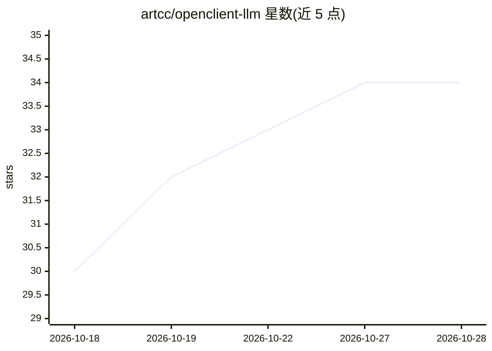

# artcc/openclient-llm

⭐ 34 · Swift · AGPL-3.0 · 推送 2026-10-22 · [GitHub](https://github.com/artcc/openclient-llm) · [官网](https://www.arturocarreterocalvo.com/openclient-llm) · 个人维护

**iOS/iPadOS/macOS 原生 LLM 聊天客户端，连接自有服务器**

SwiftUI 编写的开源 Apple 平台 LLM 客户端：直连用户配置的 LiteLLM、Ollama 或 OpenAI 兼容服务器，无官方托管代理。功能含流式 Markdown 对话、图片/PDF 附件、语音输入输出、图像生成、函数调用与 MCP 工具（经 LiteLLM 配置）、对话分支、iCloud 同步、快捷指令与桌面小组件。需 Xcode 26+/iOS 26+ 从源码构建，或经 App Store/TestFlight/macOS dmg 获取。AGPL v3.0 许可。

## 筛选速览

| 维度 | 判定 | 备注 |
|---|---|---|
| AI 角色 | `ai-ecosystem` | LLM/agent 周边工具 |
| 许可风险 | `viral` | AGPL-3.0 |
| 部署形态 | `desktop` | 安装包/桌面程序 |
| 模型依赖 | local-ok | 支持本地模型 |
| 硬件要求 | — | 无带数字的原话,不猜 |
| 安装摩擦 | `low` | 无编译、无系统依赖或容器化 |
| 成熟度 | — | 结构信号不足 |

## 能力要点

- 直连 LiteLLM / Ollama / OpenAI 兼容服务器，凭据存于 Keychain
- 支持流式对话、多模态附件、语音输入输出与图像生成
- 函数调用与经 LiteLLM 配置的 MCP 工具
- Apple 生态集成：iCloud 同步、快捷指令、Siri、小组件、菜单栏伴随程序

## 适用场景

- 在 iPhone/iPad/Mac 上使用自建 LiteLLM 或 Ollama 服务器聊天
- 用自有 API key 通过自托管网关访问多提供商模型
- 经 MCP 在对话中调用外部工具与服务

## 场景标签

`聊天机器人` `图像生成` · 领域:对话与助手

## 证据(README 行号)

> L10: OpenClient connects directly to the AI server you configure, without an OpenClient-hosted proxy or subscription.
> L13: It works with LiteLLM, Ollama, and OpenAI-compatible

## 星数曲线

2026-10-18 30 → 2026-10-28 34（+4）

---
*卡片 v1 · prompt 1.4 · 生成 2026-10-25 · 置信度 mid · 依据 README sha `e654f3e5e356` · [字段定义](../../DATASET.md)*
