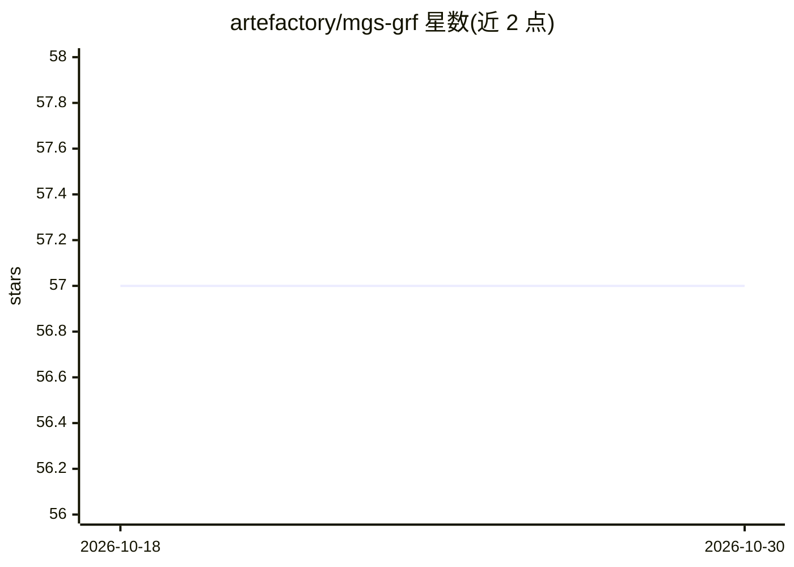

# artefactory/mgs-grf

⭐ 57 · Python · MIT · 推送 2026-09-10 · [GitHub](https://github.com/artefactory/mgs-grf) · 组织维护

**面向混合类型不平衡表格数据的过采样预处理 Python 库**

MGS-GRF 是一个数据预处理 Python 包，实现同名过采样策略：针对同时含连续与分类特征的大规模不平衡表格数据集生成合成少数类样本，以 sklearn 风格的 MGSGRFOverSampler 类供训练前调用。算法由两篇同行评审论文支撑（AISTATS 2026 连续特征版、ECML-PKDD 2025 分类特征扩展版），由 Artefact Research Center 与索邦大学 LPSM 实验室合作完成。支持 PyPI 安装与源码安装，提供 notebook 示例。

## 筛选速览

| 维度 | 判定 | 备注 |
|---|---|---|
| AI 角色 | `ai-ecosystem` | LLM/agent 周边工具 |
| 许可风险 | `permissive` | MIT |
| 部署形态 | `library` | 以包/库形式分发 |
| 模型依赖 | — | README 未给出锁定关系 |
| 硬件要求 | — | 无带数字的原话,不猜 |
| 安装摩擦 | `low` | 无编译、无系统依赖或容器化 |
| 成熟度 | — | 结构信号不足 |

## 能力要点

- 支持连续与分类混合特征的过采样
- 面向大规模不平衡表格数据集设计
- sklearn 风格 API（MGSGRFOverSampler）
- 算法由 AISTATS 2026 与 ECML-PKDD 2025 两篇论文支撑

## 适用场景

- 分类任务训练前对不平衡表格数据重采样
- 含分类变量（如银行客户属性）数据集的少数类扩充
- 复现论文中的过采样实验流程

## 场景标签

 · 领域:机器学习/数据预处理

## 证据(README 行号)

> L12: If you face *imbalance data* in your machine learning project, this package is here to pre-process your data. It is
> L13: MGS-GRF, an oversampling strategy designed to handle large-scale and mixed imbalanced data-set — with *both continu
> L49: This work was done through a partenership between **Artefact Research Center** and the **Laboratoire de Probabilité

## 星数曲线

2026-10-18 57 → 2026-10-30 57（+0）

---
*卡片 v1 · prompt 1.4 · 生成 2026-10-24 · 置信度 high · 依据 README sha `d6bedebae467` · [字段定义](../../DATASET.md)*
