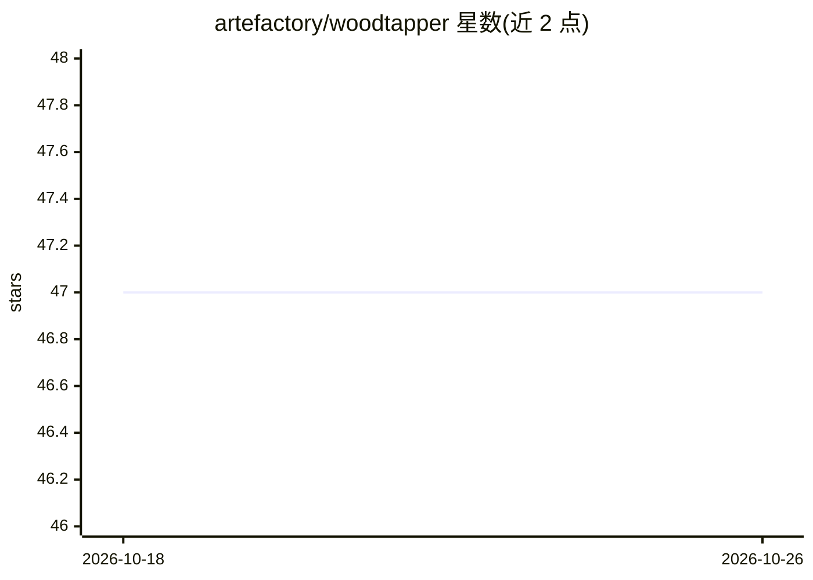

# artefactory/woodtapper

⭐ 47 · Python · MIT · 推送 2026-10-22 · [GitHub](https://github.com/artefactory/woodtapper) · [官网](https://artefactory.github.io/woodtapper/) · 组织维护

**解释和操控 scikit-learn 树集成的 Python 工具箱**

面向树集成模型的可解释性工具箱，含三个模块：从树集成提取简单规则序列（SirusClassifier）；基于 Wasserstein 距离惩罚、把人口统计学公平性纳入训练目标的二阶梯度提升（OTFairBoostClassifier）；以及将预测关联到代表性样本的基于样例的解释（RandomForestClassifierExplained）。由 Artefact Research Center 与索邦大学 LPSM 合作完成，附同行评审论文与预印本。以 pip 包形式提供，含编译的 Cython 组件，锁定 scikit-learn 1.6.1，其他版本需本地重编译，Windows 用户需 C/C++ 编译器。

## 筛选速览

| 维度 | 判定 | 备注 |
|---|---|---|
| AI 角色 | `ai-native` | 本体是模型或模型工具 |
| 许可风险 | `permissive` | MIT |
| 部署形态 | `library` | 以包/库形式分发 |
| 模型依赖 | — | README 未给出锁定关系 |
| 硬件要求 | — | 无带数字的原话,不猜 |
| 安装摩擦 | `low` | 无编译、无系统依赖或容器化 |
| 成熟度 | — | 结构信号不足 |

## 能力要点

- 从树集成提取规则序列的 RulesExtraction 模块
- Wasserstein 距离惩罚的公平性约束梯度提升 OTFairBoost
- 基于样例的解释模块返回最相似代表样本及其目标值

## 适用场景

- 我要把训练好的树集成转成可读的规则集
- 在表格数据上训练带公平性约束的分类器
- 为随机森林预测给出相似样例解释

## 场景标签

 · 领域:机器学习/可解释性

## 证据(README 行号)

> L16: - Rule extraction from tree-based ensembles: Generates a final estimator composed of a sequence of simple rule-base
> L18: - Fairness-Constrained Gradient Boosting: A second-order tree-boosting implementation that directly incorporates de
> L20: - Example-based explanations: Connects predictions to a small set of representative samples, returning the most sim

## 星数曲线

2026-10-18 47 → 2026-10-26 47（+0）

---
*卡片 v1 · prompt 1.4 · 生成 2026-10-25 · 置信度 high · 依据 README sha `1f4044a86338` · [字段定义](../../DATASET.md)*
