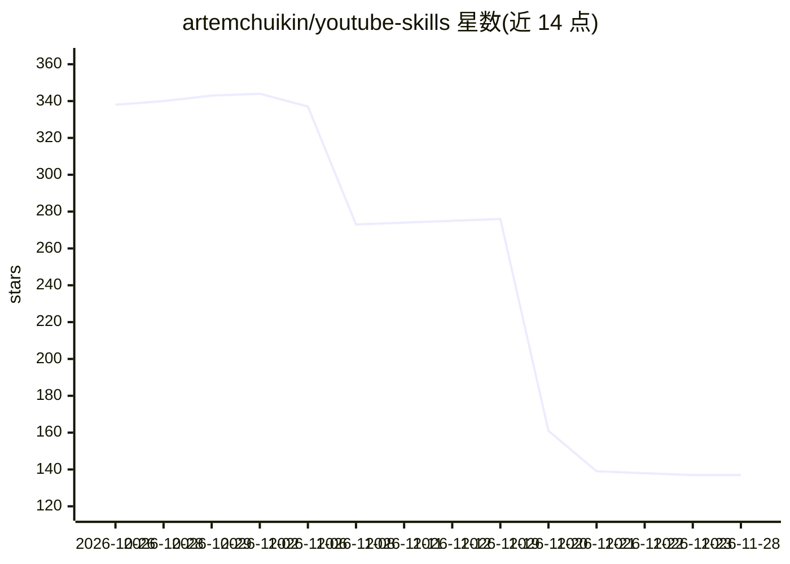

# artemchuikin/youtube-skills

⭐ 137 · MIT · 推送 2026-11-25 · [GitHub](https://github.com/artemchuikin/youtube-skills) · [官网](https://transcriptout.com/) · 个人维护

**为编码/聊天 agent 提供 YouTube 字幕获取与搜索能力的技能包**

包含 12 个 Agent Skill 格式的技能文件夹，agent 按任务匹配加载，覆盖获取视频字幕（含时间戳/SRT/VTT）、YouTube 搜索、浏览频道与播放列表、批量导出（单次任务最多 4,000 视频）、按字符段预切分以便 RAG 检索。不依赖 yt-dlp、无头浏览器或 Google Cloud 项目，底层调用 TranscriptOut 托管 API，需 API key，免费账户含 100 积分，付费计划按积分计费。支持 Claude Code、Cursor、Codex、OpenClaw、Hermes 等运行时，提供 MCP server 与 pip/npm 客户端库。

## 筛选速览

| 维度 | 判定 | 备注 |
|---|---|---|
| AI 角色 | `ai-knowledge` | 知识聚合/清单类 |
| 许可风险 | `permissive` | MIT |
| 部署形态 | `library` | 以包/库形式分发 |
| 模型依赖 | — | README 未给出锁定关系 |
| 硬件要求 | — | 无带数字的原话,不猜 |
| 安装摩擦 | `low` | 无编译、无系统依赖或容器化 |
| 成熟度 | — | 结构信号不足 |

## 能力要点

- 12 个技能覆盖字幕/搜索/频道/播放列表/批量导出
- 批量任务单次提交至多 4,000 视频，重复项扣费前去重
- segment 参数按词级时间戳切分转录文本，直接进入嵌入流水线
- 首次运行可在对话内完成 API key 注册

## 适用场景

- 让 agent 读取并总结 YouTube 视频内容
- 为 RAG 索引批量抓取播放列表转录并预切分
- 以自然语言查询频道更新或在频道内搜索
- 导出字幕文件（SRT/VTT）

## 场景标签

`RAG` `网页抓取` · 领域:效率与自动化

## 证据(README 行号)

> L6: An Agent Skill is a folder of instructions an agent loads when the task
> L7: matches. The 12 skills in this repo cover YouTube end to end. Each one names its endpoint, shows
> L12: Works with Claude Code, Cursor, Antigravity, Cline, Codex, OpenClaw, Hermes Agent, and anything

## 星数曲线

2026-10-26 338 → 2026-11-28 137（-201）

---
*卡片 v1 · prompt 1.4 · 生成 2026-11-28 · 置信度 mid · 依据 README sha `d8efd80ec985` · [字段定义](../../DATASET.md)*
