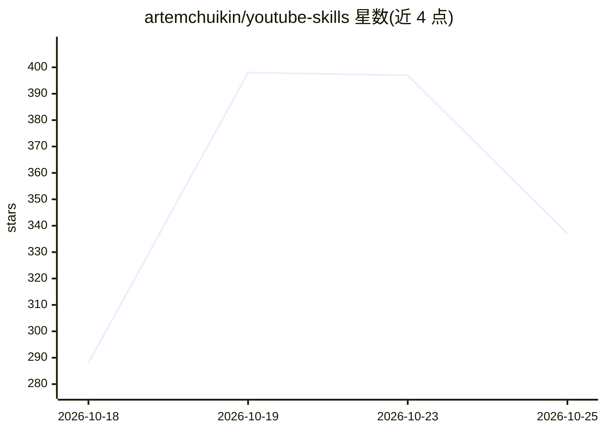

# artemchuikin/youtube-skills

⭐ 337 · MIT · 推送 2026-10-15 · [GitHub](https://github.com/artemchuikin/youtube-skills) · [官网](https://transcriptout.com/) · 组织维护

**给 AI agent 的 YouTube 转录/搜索技能包（12 个 Agent Skills）**

由 TranscriptOut 制作的 Agent Skills 集合：12 个技能文件夹让 Claude Code、Cursor、Codex、OpenClaw、Hermes Agent 等支持该格式的 agent 调用 TranscriptOut 托管 API，实现 YouTube 字幕转录、视频/频道搜索、频道与播放列表读取、最多 4,000 视频的批量导出，以及按字数（20-5,000 字符）预切块的 RAG 就绪转录输出。无需 yt-dlp、无头浏览器或 Google Cloud 项目，每次回答只需一次 HTTPS 请求。需要 sk_ 开头的 API key，免费账户含 100 积分，1 积分对应 1 次已应答请求，费率上限 200 请求/分钟/key。

## 筛选速览

| 维度 | 判定 | 备注 |
|---|---|---|
| AI 角色 | `ai-ecosystem` | LLM/agent 周边工具 |
| 许可风险 | `permissive` | MIT |
| 部署形态 | `library` | 以包/库形式分发 |
| 模型依赖 | — | README 未给出锁定关系 |
| 硬件要求 | — | 无带数字的原话,不猜 |
| 安装摩擦 | `low` | 无编译、无系统依赖或容器化 |
| 成熟度 | — | 结构信号不足 |

## 能力要点

- 12 个技能覆盖转录、搜索、频道、播放列表与批量任务
- 单次 POST 批量提交最多 4,000 视频转录，带幂等键与自动退款
- transcript 按词级时间戳预切块（segment 参数 20-5,000 字符），可直接进嵌入管线
- 首次运行内完成 API key 注册，无需 Google Cloud 项目或 OAuth

## 适用场景

- 让编程/对话 agent 直接读取 YouTube 视频字幕并回答内容问题
- 把整个频道或播放列表的转录批量导出做归档
- 获取 RAG 就绪的转录分块喂给检索索引

## 场景标签

`网页抓取` · 领域:效率与自动化

## 证据(README 行号)

> L6: An Agent Skill is a folder of instructions an agent loads when the task
> L12: Works with Claude Code, Cursor, Antigravity, Cline, Codex, OpenClaw, Hermes Agent, and anything

## 星数曲线

2026-10-18 288 → 2026-10-25 337（+49）

---
*卡片 v1 · prompt 1.4 · 生成 2026-10-22 · 置信度 mid · 依据 README sha `3595a0778d2f` · [字段定义](../../DATASET.md)*
