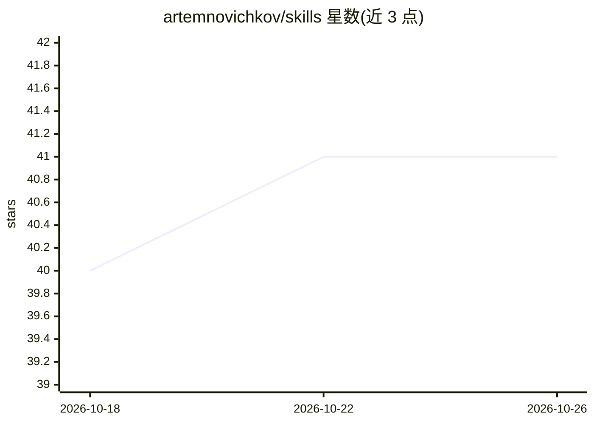

# artemnovichkov/skills

⭐ 41 · HTML · MIT · 推送 2026-10-17 · [GitHub](https://github.com/artemnovichkov/skills) · [官网](http://skills.sh/) · 个人维护

**iOS/Swift 开发用的 Claude Code agent 技能合集（6 个技能）**

面向 iOS 与 Swift 开发工作流的 agent 技能集合，包含 6 个技能：Figma 设计与实现截图对比报告、Firebase Crashlytics 崩溃报告生成与修复建议、Apple 统一日志（OSLog）读取与分析、xcodebuild 构建通知、命令行 Xcode 项目编辑、以及以制品文件驱动的软件生命周期（SDLC）流程。支持通过 npx skills、Claude Code 插件市场与 Xcode deeplink 三种方式安装。

## 筛选速览

| 维度 | 判定 | 备注 |
|---|---|---|
| AI 角色 | `ai-ecosystem` | LLM/agent 周边工具 |
| 许可风险 | `permissive` | MIT |
| 部署形态 | `library` | 以包/库形式分发 |
| 模型依赖 | — | README 未给出锁定关系 |
| 硬件要求 | — | 无带数字的原话,不猜 |
| 安装摩擦 | `medium` | 含编译或系统依赖之一 |
| 成熟度 | — | 结构信号不足 |

## 能力要点

- design-compare：Figma 节点导出与实现截图的交互式 HTML 对比报告
- crashlytics：拉取崩溃数据、分析根因并生成修复建议与开发者指派
- xcproj：命令行创建/读取/编辑/校验 Xcode 项目
- sdlc：intent→spec→plan→diff→PR 的制品驱动生命周期，含 8 个斜杠命令

## 适用场景

- iOS 开发者用 Claude Code 做 UI 还原度检查与崩溃分析
- 在 agent 辅助下按阶段制品推进软件生命周期
- 通过命令行脚本化编辑 Xcode 项目文件

## 场景标签

`提示工程` · 领域:Agent 开发

## 证据(README 行号)

> L5: A collection of agent skills for iOS and Swift development workflows — lifecycle planning, crash triage, design comp
> L86: /plugin marketplace add artemnovichkov/skills

## 星数曲线

2026-10-18 40 → 2026-10-26 41（+1）

---
*卡片 v1 · prompt 1.4 · 生成 2026-10-25 · 置信度 high · 依据 README sha `16364bdd02a1` · [字段定义](../../DATASET.md)*
