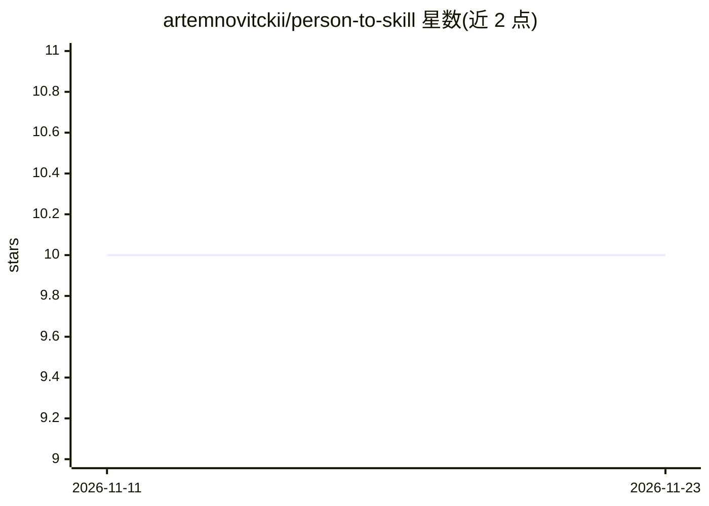

# artemnovitckii/person-to-skill

⭐ 10 · Python · MIT · 推送 2026-07-31 · [GitHub](https://github.com/artemnovitckii/person-to-skill) · 个人维护

**把书籍、文档与 YouTube 视频编译为带引用的跨 agent 技能**

一个 agent 技能生成器：读取某人的书籍、PDF/EPUB/DOCX 等文档、字幕文件和 YouTube URL，构建源账本并提炼决策框架，生成遵循 Open Agent Skills 标准的 SKILL.md 技能目录，核心规则先行、细节按需加载。生成的建议带章节/时间戳引用（如 [B01, ch.4]）、保留观点随时间的冲突，并明确不冒充本人。通过 git clone 或 Python 安装脚本部署到 Claude Code、Codex、Copilot CLI、Amp；YouTube 抓取依赖 yt-dlp。

## 筛选速览

| 维度 | 判定 | 备注 |
|---|---|---|
| AI 角色 | `ai-ecosystem` | LLM/agent 周边工具 |
| 许可风险 | `permissive` | MIT |
| 部署形态 | `library` | 以包/库形式分发 |
| 模型依赖 | — | README 未给出锁定关系 |
| 硬件要求 | — | 无带数字的原话,不猜 |
| 安装摩擦 | `low` | 无编译、无系统依赖或容器化 |
| 成熟度 | — | 结构信号不足 |

## 能力要点

- 生成带来源引用的决策框架，引用含章节号与视频时间戳
- 冲突感知：记录同一人观点随时间的变化并分类差异
- 跨 agent 兼容：同一技能可在 Claude Code、Codex、Copilot CLI、Amp 使用
- 渐进加载：核心文件小，相关主题文件按需载入

## 适用场景

- 把某位作者的多本书和几十个视频整合成一个可复用的咨询技能
- 为多个 agent 工具安装同一份人物知识技能
- 追踪某人观点随时间的修正与冲突记录

## 场景标签

`提示工程` · 领域:Agent 开发

## 证据(README 行号)

> L20: `person-to-skill` turns one person's books, documents, transcripts, and YouTube videos into a reusable AI advisor s
> L47: - **Cross-agent** — one open-standard skill works across Claude Code, Codex, Copilot CLI, and Amp.
> L103: This is primarily an **agent skill**, not a conventional CLI application. Invoke it inside your agent and describe

## 星数曲线

2026-11-11 10 → 2026-11-23 10（+0）

---
*卡片 v1 · prompt 1.4 · 生成 2026-11-20 · 置信度 mid · 依据 README sha `dc72cf367a0d` · [字段定义](../../DATASET.md)*
