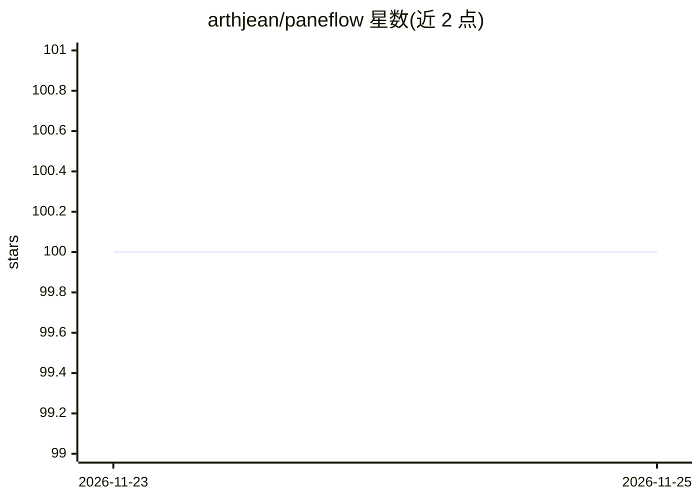

# arthjean/paneflow

⭐ 100 · Rust · GPL-3.0 · 推送 2026-11-23 · [GitHub](https://github.com/arthjean/paneflow) · [官网](https://paneflow.dev) · 个人维护

**面向编码 agent 的原生终端复用器：并行运行与审阅改动**

用 Rust 与 Zed 的 GPUI 构建、内嵌 Ghostty `libghostty-vt` 终端引擎的原生终端复用器，面向编码 agent 场景：按项目组织为标签页与分屏，在现有 checkout 或新建分支/Git worktree 中运行多个 CLI agent；提供 Changes（与 HEAD 的 diff）、Files（带 Git 标记的编辑器）与终端组成的 dock，可读取、中断或接管任意终端。终端会话驻留独立宿主进程，关闭应用后会话可保持。GPL-3.0-or-later。

## 筛选速览

| 维度 | 判定 | 备注 |
|---|---|---|
| AI 角色 | `ai-ecosystem` | LLM/agent 周边工具 |
| 许可风险 | `viral` | GPL-3.0 |
| 部署形态 | `desktop` | 安装包/桌面程序 |
| 模型依赖 | — | README 未给出锁定关系 |
| 硬件要求 | — | 无带数字的原话,不猜 |
| 安装摩擦 | `low` | 无编译、无系统依赖或容器化 |
| 成熟度 | — | 结构信号不足 |

## 能力要点

- 支持任意 CLI agent（Claude Code、Codex、Gemini、opencode 等）并行运行
- MCP 桥接让 agent 读取其他 agent 的窗格（read_pane/write_pane 等工具）
- paneflow CLI 支持脚本化读取、监视与控制窗格，flow.toml 声明式编排
- Changes 标签页展示 checkout 对 HEAD 的 diff 并可逐块回退

## 适用场景

- 在多个分屏中并行运行多个编码 agent 并跟踪其活动
- 关闭应用后保持 agent 会话运行，重开后重新连接
- 审阅 agent 产生的代码改动并撤销个别代码块
- 用脚本或 agent 编排一批窗格执行 flow.toml 定义的工作流

## 场景标签

`编码 Agent` · 领域:编码与开发

## 证据(README 行号)

> L10: Paneflow is a native terminal multiplexer for coding agents. Run agents in parallel, keep their sessions running wh
> L16: Paneflow runs locally: agents are ordinary CLI processes in ordinary terminals and connect to their own model provi
> L18: Free and open source under GPL-3.0-or-later. Built with Rust and Zed's GPUI, using Ghostty's `libghostty-vt` termin

## 星数曲线

2026-11-23 100 → 2026-11-25 100（+0）

---
*卡片 v1 · prompt 1.4 · 生成 2026-11-23 · 置信度 high · 依据 README sha `3ba3a336a77d` · [字段定义](../../DATASET.md)*
