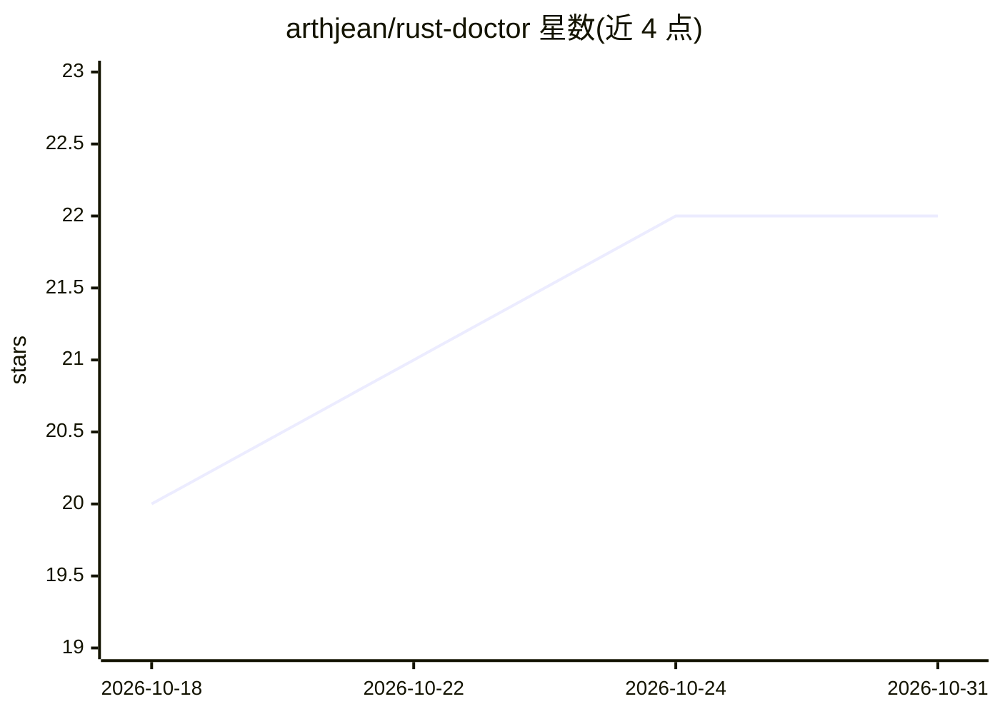

# arthjean/rust-doctor

⭐ 22 · Rust · Apache-2.0 · 推送 2026-10-29 · [GitHub](https://github.com/arthjean/rust-doctor) · [官网](rust-doctor.com) · 个人维护

**审查 AI 生成 Rust 代码的本地静态分析工具**

针对 Cargo workspace 的本地静态分析 CLI：以 142 条规则扫描安全、正确性、可靠性、性能、可维护性与依赖问题，输出百分制评分与优先修复建议。支持接入编码 agent（Claude Code、Codex、Cursor）：安装技能文件、git pre-commit 钩子与 end-of-turn 钩子，每轮重扫并可阻断新增警告；也可在 CI 中只报告 PR 引入的问题。二进制自身不联网、不上传遥测。经 npx 运行，规则可用 rust-doctor.toml 或命令行配置。

## 筛选速览

| 维度 | 判定 | 备注 |
|---|---|---|
| AI 角色 | `ai-ecosystem` | LLM/agent 周边工具 |
| 许可风险 | `permissive` | Apache-2.0 |
| 部署形态 | `library` | 以包/库形式分发 |
| 模型依赖 | — | README 未给出锁定关系 |
| 硬件要求 | — | 无带数字的原话,不猜 |
| 安装摩擦 | `low` | 无编译、无系统依赖或容器化 |
| 成熟度 | — | 结构信号不足 |

## 能力要点

- 142 条规则覆盖安全/正确性/性能/依赖等 6 类，输出百分制评分
- 为 Claude Code/Codex/Cursor 写入技能与 pre-commit/end-of-turn 钩子
- GitHub Action 模式仅对 PR 引入的问题失败并输出 score/introduced/fixed
- 本地运行，无网络连接、无遥测

## 适用场景

- 让编码 agent 修完代码后自动重扫并阻断新增警告
- CI 中只审查 PR 引入的 Rust 问题并贴粘性评论
- 对本地 Cargo workspace 做一次全面审计拿评分

## 场景标签

`代码审查` · 领域:编码与开发

## 证据(README 行号)

> L28: Once you have an audit, set up the loop so your coding agent fixes what it found. The skill teaches it which findin
> L34: This detects Claude Code, Codex and Cursor from their commands on `PATH` and their project directories, then writes

## 星数曲线

2026-10-18 20 → 2026-10-31 22（+2）

---
*卡片 v1 · prompt 1.4 · 生成 2026-10-28 · 置信度 high · 依据 README sha `fa5034e32421` · [字段定义](../../DATASET.md)*
