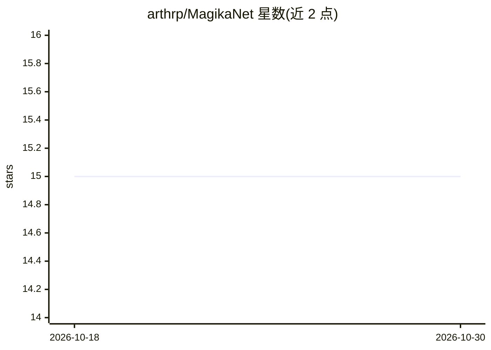

# arthrp/MagikaNet

⭐ 15 · C# · Apache-2.0 · 推送 2026-02-15 · [GitHub](https://github.com/arthrp/MagikaNet) · 个人维护

**.NET 的 Magika 绑定：AI 文件类型检测库**

MagikaNet 是 Google Magika 文件类型检测库的 .NET 封装，通过 magika_ffi 以 FFI 方式暴露 Magika 函数，供 .NET/C# 开发者在代码中调用（如 DetectPath 识别文件类型）。仓库内置 linux_x64、win_x64、macos_arm64 等主流平台的二进制文件，无需用户自行编译原生依赖，并附带测试。README 简短，仅含简介、特性与 C# 示例代码。

## 筛选速览

| 维度 | 判定 | 备注 |
|---|---|---|
| AI 角色 | `ai-native` | 本体是模型或模型工具 |
| 许可风险 | `permissive` | Apache-2.0 |
| 部署形态 | `None` |  |
| 模型依赖 | — | README 未给出锁定关系 |
| 硬件要求 | — | 无带数字的原话,不猜 |
| 安装摩擦 | `low` | 无编译、无系统依赖或容器化 |
| 成熟度 | — | 结构信号不足 |

## 能力要点

- 通过 magika_ffi 以 FFI 暴露 Magika 文件类型检测能力
- 内置 linux_x64 / win_x64 / macos_arm64 二进制，无需自行编译
- 提供 C# API（MagikaClient.DetectPath 等示例）

## 适用场景

- .NET 项目中对上传文件做基于 AI 的类型检测
- 在 C# 代码里识别文件真实格式而非仅看扩展名

## 场景标签

 · 领域:开发库/文件检测

## 证据(README 行号)

> L3: .NET wrapper for magika - AI-powered library for file type detection. Powered by magika_ffi that exposes magika func
> L7: * Batteries included - binaries are provided for all major platforms (linux_x64, win_x64, macos_arm64).

## 星数曲线

2026-10-18 15 → 2026-10-30 15（+0）

---
*卡片 v1 · prompt 1.4 · 生成 2026-10-30 · 置信度 high · 依据 README sha `ebc7ce769a1f` · [字段定义](../../DATASET.md)*
