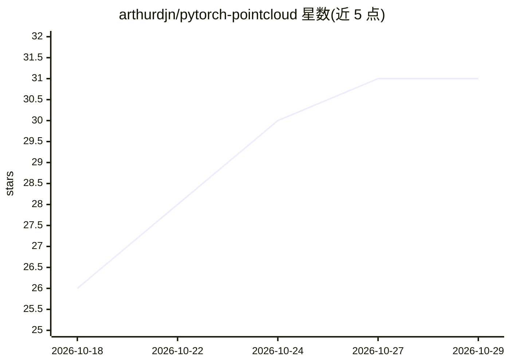

# arthurdjn/pytorch-pointcloud

⭐ 31 · Python · Apache-2.0 · 推送 2026-10-27 · [GitHub](https://github.com/arthurdjn/pytorch-pointcloud) · [官网](https://pytorch-pointcloud.org) · 个人维护

**点云深度学习模型库：提供预训练权重与统一接口**

面向 3D 点云的 PyTorch 模型库，收录 PointNet++、KPConv、RandLA-Net、VoteNet、SPVCNN、3DETR、PointTransformer、OctFormer、PointMamba 等模型的实现、预训练权重、数据集处理与推理接口，风格类似 timm 与 PyG。支持分类、部件分割、室内分割检测、LiDAR 分割检测等任务；checkpoint 携带预处理变换、指标与许可信息。多数模型需 pyg-lib，部分需为对应 torch/CUDA 版本编译扩展（spconv、flash-attn 等）。作者自述处于 alpha 阶段，预期存在破坏性变更。

## 筛选速览

| 维度 | 判定 | 备注 |
|---|---|---|
| AI 角色 | `ai-native` | 本体是模型或模型工具 |
| 许可风险 | `permissive` | Apache-2.0 |
| 部署形态 | `library` | 以包/库形式分发 |
| 模型依赖 | — | README 未给出锁定关系 |
| 硬件要求 | — | 无带数字的原话,不猜 |
| 安装摩擦 | `medium` | 含编译或系统依赖之一 |
| 成熟度 | `idea` | |

## 能力要点

- 收录多种点云架构的预训练权重与统一创建接口
- checkpoint 附带预处理变换、指标、许可等元信息
- 以 timm/PyG 风格组织，提供 inferers 与 transforms

## 适用场景

- 直接加载预训练点云模型做分割或检测推理
- 跨架构复用 backbone 与 layers 并做基准比较
- 配合自有数据训练点云模型（附训练配方示例）

## 场景标签

`目标检测` · 领域:感知与多模态

## 证据(README 行号)

> L3:  Deep learning on point clouds, with PyTorch.
> L58: model, info = tp.create_model("randlanet.semantickitti.tsung-han-wu", task="semantic-segmentation", pretrained=True

## 星数曲线

2026-10-18 26 → 2026-10-29 31（+5）

---
*卡片 v1 · prompt 1.4 · 生成 2026-10-26 · 置信度 high · 依据 README sha `0c9f45e86bfb` · [字段定义](../../DATASET.md)*
