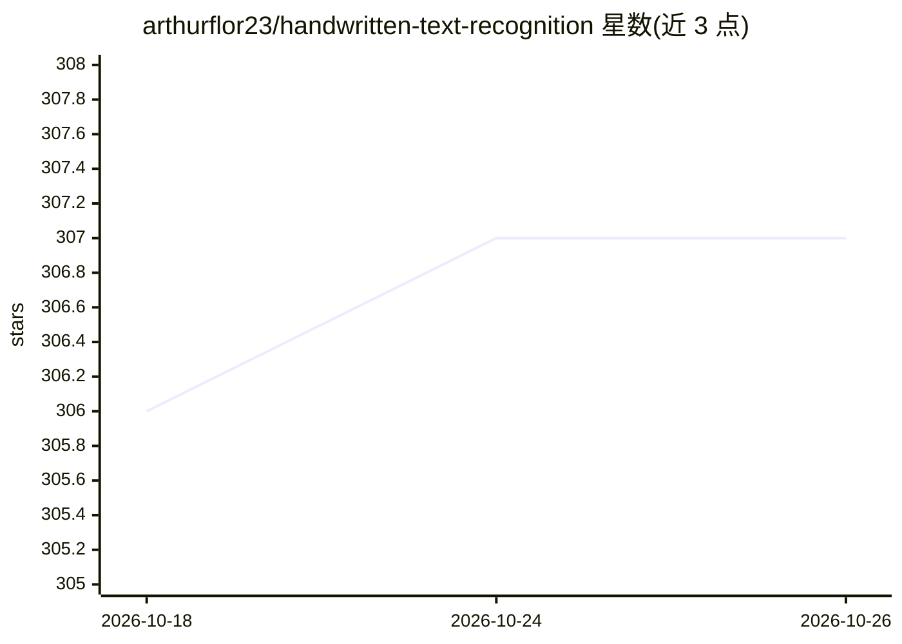

# arthurflor23/handwritten-text-recognition

⭐ 307 · Python · MIT · 推送 2026-09-04 · [GitHub](https://github.com/arthurflor23/handwritten-text-recognition) · [官网](https://arthurflor23.medium.com/handwritten-text-synthesis-and-recognition-cf5bcf2aaeb8) · 个人维护

**基于 TensorFlow 的手写文本识别与合成工具集（pySarah）**

pySarah 项目提供手写文本识别（HTR）的完整工作流：数据处理、模型训练、测试与推理，支持合成、识别、分割、书写者识别与拼写纠正等多类模型，模型可选用 flor 等。已集成 IAM、RIMES、Bentham、BRESSAY 等 12 个手写数据集，支持以 .ttf 字体原型作为生成输入，提供十余种数据增强变换。训练与测试通过 MLflow Tracking 记录并可比较实验。以 git clone 源码方式安装，需 Python>=3.11,<3.13，通过 sarah 命令行驱动，附可在 Google Colab 运行的教程 Notebook。

## 筛选速览

| 维度 | 判定 | 备注 |
|---|---|---|
| AI 角色 | `ai-native` | 本体是模型或模型工具 |
| 许可风险 | `permissive` | MIT |
| 部署形态 | `library` | 以包/库形式分发 |
| 模型依赖 | — | README 未给出锁定关系 |
| 硬件要求 | — | 无带数字的原话,不猜 |
| 安装摩擦 | `low` | 无编译、无系统依赖或容器化 |
| 成熟度 | — | 结构信号不足 |

## 能力要点

- 手写文本识别/合成/分割/书写者识别/拼写纠正多模型工作流
- 12 个数据集（IAM、RIMES、Bentham、BRESSAY、Saint Gall 等）开箱集成
- MLflow Tracking 记录训练测试实验，可比较指标并复用模型
- 十余种图像数据增强变换（mixup、elastic、perspective 等）与字体原型输入

## 适用场景

- 在手写数据集上训练并测试 HTR 识别模型
- 生成合成手写样本缓解数据稀缺
- 对手写图像运行推理并做拼写纠正

## 场景标签

`OCR` `图像生成` `模型训练` · 领域:内容生成

## 证据(README 行号)

> L3: The `pySarah` project provides a solution for Handwritten Text Recognition (HTR) using Tensorflow. It includes a tut
> L91: - `--synthesis`: Specify synthesis model (e.g., flor).

## 星数曲线

2026-10-18 306 → 2026-10-26 307（+1）

---
*卡片 v1 · prompt 1.4 · 生成 2026-10-21 · 置信度 mid · 依据 README sha `e5688af7832e` · [字段定义](../../DATASET.md)*
