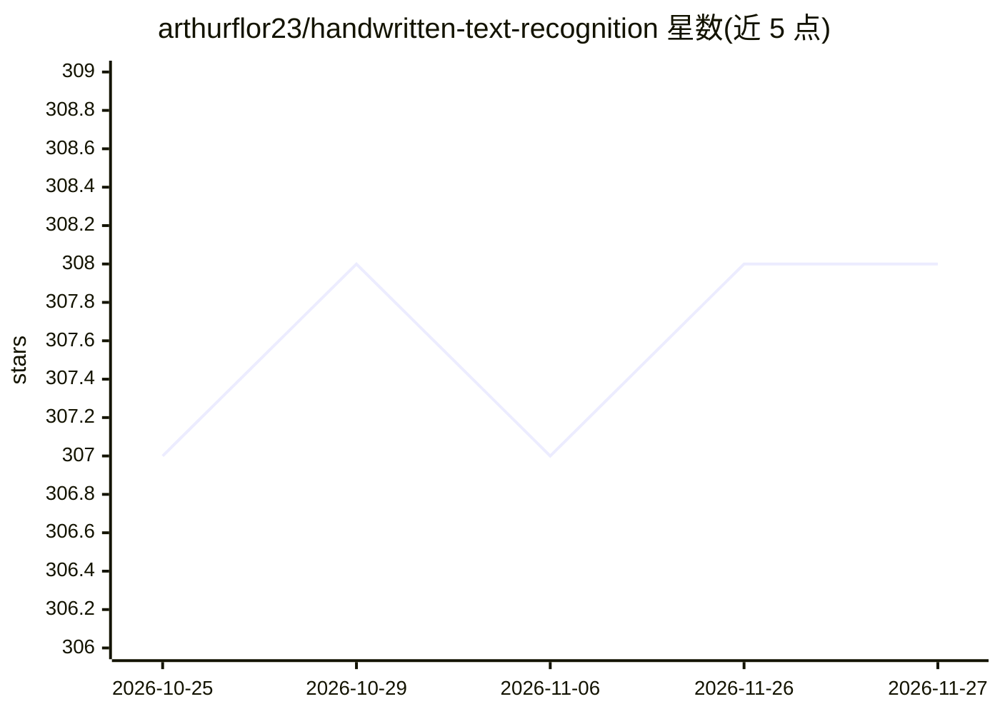

# arthurflor23/handwritten-text-recognition

⭐ 308 · Python · MIT · 推送 2026-11-02 · [GitHub](https://github.com/arthurflor23/handwritten-text-recognition) · [官网](https://arthurflor23.medium.com/handwritten-text-synthesis-and-recognition-cf5bcf2aaeb8) · 个人维护

**给研究者的手写文本识别训练与推理工具集**

基于 TensorFlow 的手写文本识别（HTR）解决方案，提供数据处理、模型训练、测试与推理的命令行工具。内置对 Bentham、IAM、RIMES 等 12 个数据集的集成，支持合成模型、拼写校正、作者识别与分割模型，并集成 MLflow 用于实验跟踪与模型存档。需 Python 3.11–3.13，通过 git clone 与 pip 安装依赖，支持 GPU 索引指定。

## 筛选速览

| 维度 | 判定 | 备注 |
|---|---|---|
| AI 角色 | `ai-native` | 本体是模型或模型工具 |
| 许可风险 | `permissive` | MIT |
| 部署形态 | `library` | 以包/库形式分发 |
| 模型依赖 | — | README 未给出锁定关系 |
| 硬件要求 | — | 无带数字的原话,不猜 |
| 安装摩擦 | `low` | 无编译、无系统依赖或容器化 |
| 成熟度 | — | 结构信号不足 |

## 能力要点

- 集成 12 个手写数据集（IAM/RIMES/Bentham 等）用于训练与评估
- 支持识别、合成、分割、作者识别、拼写校正多类模型
- MLflow 实验跟踪：记录指标、对比实验、存储模型
- 支持 20 余种数据增强变换（弹性/透视/噪声等）与 .ttf 字体输入

## 适用场景

- 在 IAM、RIMES 等数据集上训练手写识别模型
- 对输入图片执行手写文本识别推理
- 生成手写风格合成数据以扩充训练集

## 场景标签

`模型训练` `OCR` · 领域:感知与多模态

## 证据(README 行号)

> L3: The `pySarah` project provides a solution for Handwritten Text Recognition (HTR) using Tensorflow. It includes a set
> L55: The project supports a wide range of datasets for handwritten text recognition. The following datasets are already 

## 星数曲线

2026-10-25 307 → 2026-11-27 308（+1）

---
*卡片 v1 · prompt 1.4 · 生成 2026-11-25 · 置信度 high · 依据 README sha `353f309820d9` · [字段定义](../../DATASET.md)*
