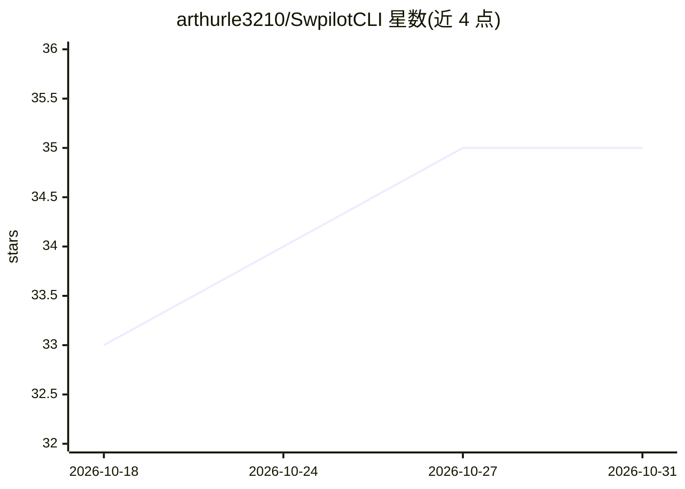

# arthurle3210/SwpilotCLI

⭐ 35 · C# · NOASSERTION · 推送 2026-10-20 · [GitHub](https://github.com/arthurle3210/SwpilotCLI) · 个人维护

**嵌入 Claude Code/Codex CLI 的 SolidWorks AI 自动化插件**

C# .NET 编写的 SolidWorks Add-in，将 Claude Code CLI 或 Codex CLI 嵌入任务窗格，用自然语言驱动 SolidWorks 特征操作：将手绘工程图转为零件、生成 SolidWorks 宏、分类整理文件等。通过 swapi-pilot-solidworks-mcp 查询 SolidWorks API，并带视觉系统读取屏幕校验结果。核心机制是工具积累：完成的任务可提升为 sup_tools 可复用工具，TOOLS.md 自动索引，相似任务直接复用。要求本机安装 SolidWorks 与付费的 Claude/Codex 订阅，安装由 AI CLI 按 Install.md 自动完成。

## 筛选速览

| 维度 | 判定 | 备注 |
|---|---|---|
| AI 角色 | `ai-native` | 本体是模型或模型工具 |
| 许可风险 | `none` | NOASSERTION |
| 部署形态 | `None` |  |
| 模型依赖 | locked-api |  |
| 硬件要求 | — | 无带数字的原话,不猜 |
| 安装摩擦 | `medium` | 含编译或系统依赖之一 |
| 成熟度 | — | 结构信号不足 |

## 能力要点

- 自然语言描述任务，自动创建并验证 SolidWorks 自动化工具
- sup_tools 工具提升与 TOOLS.md 索引，实现任务复用积累
- 基于 swapi-pilot-solidworks-mcp 查询 SolidWorks API
- 视觉系统可查看 SolidWorks 屏幕以检查模型与图纸

## 适用场景

- 把手绘工程图直接转成 SolidWorks 零件
- 用自然语言生成批量处理零件文件的 SolidWorks 宏
- 让 AI 自动分类整理 SolidWorks 文件目录

## 场景标签

`GUI 自动化` · 领域:效率与自动化

## 证据(README 行号)

> L26: 1. Describe your SolidWorks task, and SwpilotCLI creates a Tool automatically.
> L68: 1. Your computer must have Claude Code CLI, Codex CLI, or another AI model for CLI that can run from CMD.
> L116: The reason SwpilotCLI can control SolidWorks so well is that it uses `swapi-pilot-solidworks-mcp` to query the Sol

## 星数曲线

2026-10-18 33 → 2026-10-31 35（+2）

---
*卡片 v1 · prompt 1.4 · 生成 2026-10-25 · 置信度 high · 依据 README sha `047251ed7c5f` · [字段定义](../../DATASET.md)*
