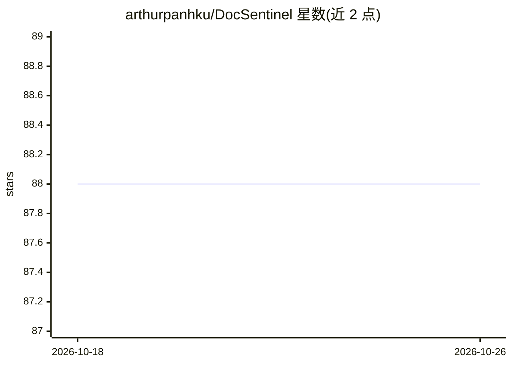

# arthurpanhku/DocSentinel

⭐ 88 · Python · MIT · 推送 2026-10-22 · [GitHub](https://github.com/arthurpanhku/DocSentinel) · 个人维护 · 中文 README

**面向安全团队的 AI SSDLC 平台：自动评估安全文档与合规**

基于 React 控制台 + FastAPI 服务 + MCP/A2A 网关的 SSDLC（安全软件开发生命周期）平台，用 LangChain/LangGraph 编排六个阶段专属 AI agent，对安全文档、问卷和报告做多格式解析与自动评估，输出含风险项、合规差距与修复建议的结构化报告。支持上传组织政策与标准构建 RAG 知识库作为评估依据；可接入 OpenAI、Anthropic、Qwen、DeepSeek 或本地 Ollama。评估结果进入人工审核队列，agent 不能自行批准；提供 MCP 工具供 Claude Desktop、Cursor 等编码 agent 调用。

## 筛选速览

| 维度 | 判定 | 备注 |
|---|---|---|
| AI 角色 | `ai-native` | 本体是模型或模型工具 |
| 许可风险 | `permissive` | MIT |
| 部署形态 | `library` | 以包/库形式分发 |
| 模型依赖 | local-ok | 支持本地模型 |
| 硬件要求 | — | 无带数字的原话,不猜 |
| 安装摩擦 | `low` | 无编译、无系统依赖或容器化 |
| 成熟度 | — | 结构信号不足 |

## 能力要点

- 覆盖 6 个 SSDLC 阶段的专属 AI agent 与技能（STRIDE/DREAD 威胁建模、SAST/DAST 分诊等）
- 多 LLM 接入：OpenAI、Anthropic、Qwen、DeepSeek 或本地 Ollama，单一接口切换
- RAG 知识库按阶段分集合，检索组织政策与标准作为评估依据
- 威胁证据 Critic：对 STRIDE 威胁给出 supported/contradicted/insufficient_evidence 判定并附来源摘录

## 适用场景

- 安全团队批量处理安全问卷与审计报告，生成结构化风险评估
- 在需求与设计阶段早期做自动威胁建模与合规差距分析
- 让 Claude Desktop/Cursor 等编码 agent 通过 MCP 调用安全评估能力
- 用组织政策与标准知识库支撑一致的评估结论

## 场景标签

`网络安全` `文档解析` · 领域:知识与检索

## 证据(README 行号)

> L26: **DocSentinel** is an AI-powered **SSDLC (Secure Software Development Lifecycle) platform** for security teams. It 
> L143: Submit security questionnaires, design documents, or audit reports. DocSentinel analyzes them using configured LLM

## 星数曲线

2026-10-18 88 → 2026-10-26 88（+0）

---
*卡片 v1 · prompt 1.4 · 生成 2026-10-23 · 置信度 mid · 依据 README sha `cf2ba432a44b` · [字段定义](../../DATASET.md)*
