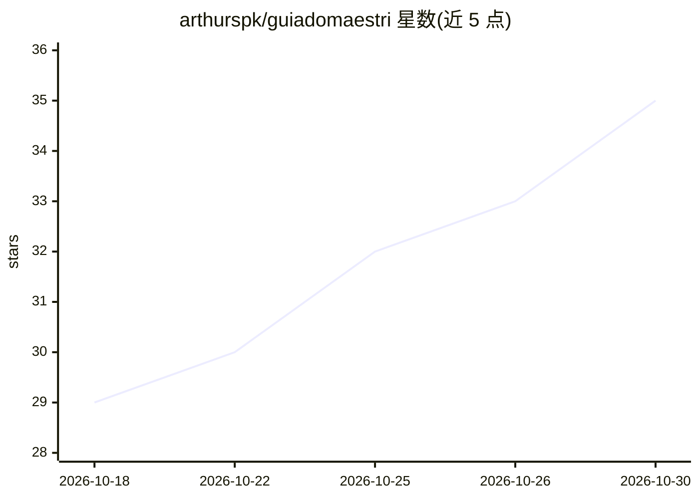

# arthurspk/guiadomaestri

⭐ 35 · Python · 推送 2026-09-09 · [GitHub](https://github.com/arthurspk/guiadomaestri) · 个人维护 · 中文 README

**Maestri 应用模板指南与生成器：257 个多 agent 编排模板**

围绕 macOS/Windows 应用 Maestri（无限画布上编排 Claude Code、Codex、Gemini 等代码 agent 团队）的使用指南与 Python 模板生成器：按 12 个业务领域（技术为主，含 212 个工程模板）生成 257 份 .maestripartitura 格式的团队模板文件，可拖入画布使用；模板内含职责、笔记、门户与连接。另提供 role.json、终端主题、CLAUDE.md/AGENTS.md 模板、提示词库等可导入资源。生成器仅依赖 Python 3 标准库，重建产出字节级一致。

## 筛选速览

| 维度 | 判定 | 备注 |
|---|---|---|
| AI 角色 | `ai-knowledge` | 知识聚合/清单类 |
| 许可风险 | `none` | — |
| 部署形态 | `None` |  |
| 模型依赖 | — | README 未给出锁定关系 |
| 硬件要求 | — | 无带数字的原话,不猜 |
| 安装摩擦 | `low` | 无编译、无系统依赖或容器化 |
| 成熟度 | — | 结构信号不足 |

## 能力要点

- 257 个 .maestripartitura 模板覆盖 12 个领域（技术类 212 个）
- 附 30 个 role.json 角色、笔记模板与提示词库等可导入资源
- 生成与校验脚本仅依赖 Python 3 标准库，UUID 确定性可复现
- 文档覆盖画布概念、日常流程、模型策略与安全注意事项

## 适用场景

- 在 Maestri 中导入现成的多 agent 团队模板直接开始工作
- 为不同技术栈选择 Ship Feature、调试、发布门禁等团队编排模式
- 复用角色定义与 CLAUDE.md/AGENTS.md 模板配置 agent 工作区

## 场景标签

`多智能体` `提示工程` · 领域:Agent 开发

## 证据(README 行号)

> L9: > O **Maestri** é um app de **macOS e Windows** onde você **rege um time de agentes de código** — Claude Code, Codex
> L146: > Todo o hub é gerado por Python (só stdlib). Detalhes de uso e como estender em `scripts/README.md`.
> L152: |`scripts/generate_partituras.py`|gerador|Monta as 257 partituras por área, os pacotes e os catálogos.|

## 星数曲线

2026-10-18 29 → 2026-10-30 35（+6）

---
*卡片 v1 · prompt 1.4 · 生成 2026-10-25 · 置信度 high · 依据 README sha `a736a331e6ad` · [字段定义](../../DATASET.md)*
