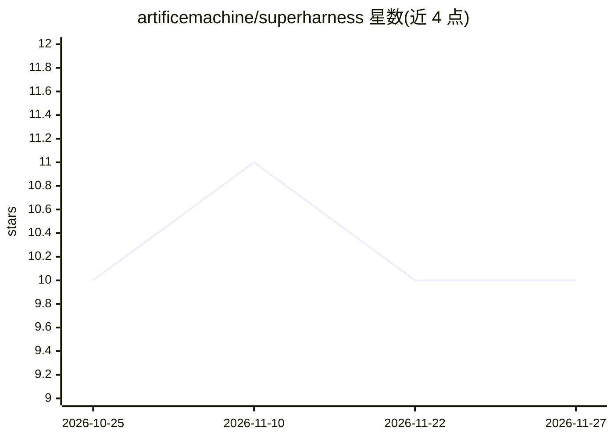

# artificemachine/superharness

⭐ 10 · Python · NOASSERTION · 推送 2026-11-26 · [GitHub](https://github.com/artificemachine/superharness) · 个人维护

**协调多个 AI 编码 agent 的任务编排工具**

以 CLI（shux）与 Claude Code 插件形式提供的多 agent 编排工具：围绕同一项目创建讨论（多轮共识）与任务（owner、生命周期、handoff），通过 SQLite 共享契约、队列委派与后台 watcher 跨会话协调 Claude Code、Codex CLI、Gemini CLI、OpenCode、Pi、Hermes 六种 agent。提供状态面板、失败模式分类注入修复提示、fan-out/swarm 并行派发、Langfuse 可选遥测；6,200+ 测试覆盖。终端路径要求 bash 与 python3。

## 筛选速览

| 维度 | 判定 | 备注 |
|---|---|---|
| AI 角色 | `ai-ecosystem` | LLM/agent 周边工具 |
| 许可风险 | `permissive` | NOASSERTION |
| 部署形态 | `desktop` | 安装包/桌面程序 |
| 模型依赖 | — | README 未给出锁定关系 |
| 硬件要求 | — | 无带数字的原话,不猜 |
| 安装摩擦 | `low` | 无编译、无系统依赖或容器化 |
| 成熟度 | — | 结构信号不足 |

## 能力要点

- 六种 agent 的统一 Harness 适配器注册表与委派路由
- 任务生命周期管理（todo→plan→in_progress→report_ready→done）与依赖跟踪
- 失败模式分类器（15 种）注入修复提示、技能提取到 skills.yaml
- shux status 一屏展示健康状态，支持 CI 模式 --check

## 适用场景

- 让多个 AI 编码助手在同一项目协作并避免编辑冲突
- agent 崩溃后由后续会话从持久化状态续做任务
- 用 fan-out/git worktree 并行派发并比较多个解法

## 场景标签

`多智能体` · 领域:Agent 开发

## 证据(README 行号)

> L10: **Create discussions, manage tasks, and coordinate agents across Claude Code, Codex CLI, Gemini CLI, OpenCode, Pi, 
> L12: superharness lets AI coding assistants work on the same project through discussions and tasks. A discussion brings 
> L148: A task's `owner` and `shux delegate --to <agent>` accept any of these agents:

## 星数曲线

2026-10-25 10 → 2026-11-27 10（+0）

---
*卡片 v1 · prompt 1.4 · 生成 2026-11-18 · 置信度 mid · 依据 README sha `d9651fd2f72c` · [字段定义](../../DATASET.md)*
