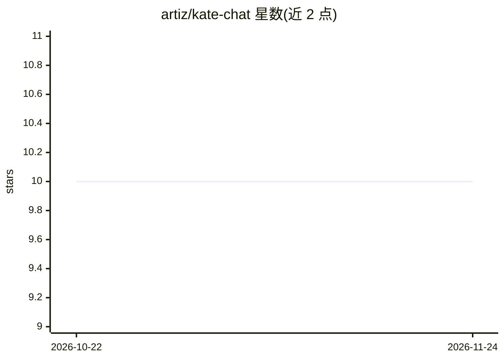

# artiz/kate-chat

⭐ 10 · TypeScript · MIT · 推送 2026-11-13 · [GitHub](https://github.com/artiz/kate-chat) · 个人维护

**自托管通用聊天机器人平台：多 LLM 切换 + RAG + MCP**

Node.js/Rust 实现的通用聊天平台，可定制为自有聊天机器人。支持会话内切换多个 LLM 提供商模型，接入外部 MCP 服务器（含 OAuth）与内置 Gmail/Teams/Telegram MCP，提供基于 Docling 解析与向量嵌入的 RAG（SQLite/PostgreSQL/MS SQL）。还包含语音实时对话、图像生成、Pyodide 代码执行、文件生成 Skills、请求队列与统计等功能；提供 live demo 与 docker-compose 生产级开发环境。

## 筛选速览

| 维度 | 判定 | 备注 |
|---|---|---|
| AI 角色 | `ai-ecosystem` | LLM/agent 周边工具 |
| 许可风险 | `permissive` | MIT |
| 部署形态 | `self-host` | docker 或自建部署 |
| 模型依赖 | local-ok | 支持本地模型 |
| 硬件要求 | — | 无带数字的原话,不猜 |
| 安装摩擦 | `low` | 无编译、无系统依赖或容器化 |
| 成熟度 | — | 结构信号不足 |

## 能力要点

- 会话内切换多提供商模型，支持 OpenAI 兼容自定义端点
- RAG：Docling 解析 PDF/DOCX/TXT，向量嵌入存于 PostgreSQL/Sqlite/MS SQL
- 外部与内部 MCP 服务器支持，工具调用需用户批准
- 语音实时对话（OpenAI GPT Realtime/Yandex Speech Realtime）与图像输入/生成

## 适用场景

- 搭建自有品牌的定制化聊天机器人
- 在统一界面里接入多个 LLM 提供商并自由切换
- 构建带文档问答与语义检索的 RAG 应用
- 通过 MCP 服务器让聊天模型调用 Gmail/Teams/Telegram 等工具

## 场景标签

`聊天机器人` `RAG` `文档问答` · 领域:对话与助手

## 证据(README 行号)

> L3: _KateChat_ is a universal chatbot platform similar to chat.openai.com that can be used as a base for customized chat
> L47: - Support for various LLM model Providers:
> L51: - Custom OpenAI-compatible REST API endpoints support (Deepseek, local Ollama, etc.).
> L53: - Full-fledged production-like dev environment with docker-compose

## 星数曲线

2026-10-22 10 → 2026-11-24 10（+0）

---
*卡片 v1 · prompt 1.4 · 生成 2026-11-20 · 置信度 high · 依据 README sha `95ed31075d40` · [字段定义](../../DATASET.md)*
