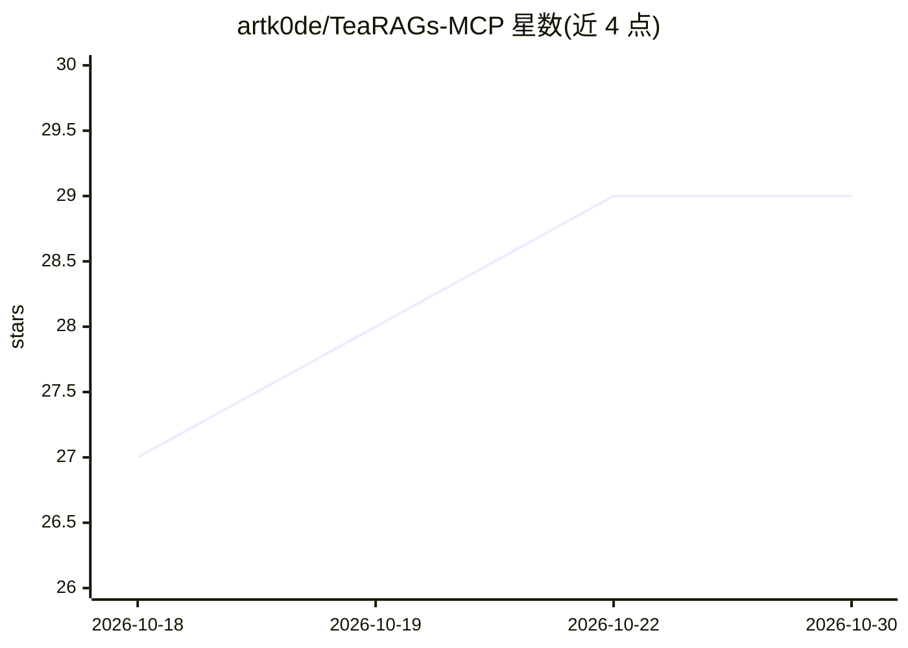

# artk0de/TeaRAGs-MCP

⭐ 29 · TypeScript · NOASSERTION · 推送 2026-10-28 · [GitHub](https://github.com/artk0de/TeaRAGs-MCP) · [官网](https://artk0de.github.io/TeaRAGs-MCP/) · 个人维护

**给 AI 编程代理的代码库情报层：五层索引经 MCP 供查询**

本地运行的 Codebase Intelligence 层，通过 MCP 协议供 AI 编程代理查询。它将仓库在本机索引为五层：语义/混合检索（AST 边界分块）、调用图导航（callers/trace_path/影响面）、基于 Git 历史的风险档案（提交数、bug 修复占比、作者）、架构诊断（依赖方向、泄漏的 facade、隐式耦合）与命名词典（对 diff 中新命名给出裁决）。附带 agent skills 与意图到工具的路由决策表。以 npm 包形式分发。

## 筛选速览

| 维度 | 判定 | 备注 |
|---|---|---|
| AI 角色 | `ai-ecosystem` | LLM/agent 周边工具 |
| 许可风险 | `none` | NOASSERTION |
| 部署形态 | `library` | 以包/库形式分发 |
| 模型依赖 | — | README 未给出锁定关系 |
| 硬件要求 | — | 无带数字的原话,不猜 |
| 安装摩擦 | `low` | 无编译、无系统依赖或容器化 |
| 成熟度 | — | 结构信号不足 |

## 能力要点

- 五层索引：Semantic index、Codegraph、Trajectory、Architecture、Lexicon，统一 MCP 接口
- 结果附带 dossier：提交数、bug 修复占比、年龄、作者等按仓库自身百分位标注
- 架构诊断四检测器与命名裁决（CONFORMS/MISFIT/NEW_TERM/COLLISION）
- 100% 本地运行，附带按意图自动选择工具与 rerank 预设的 agent skills

## 适用场景

- 让编程代理在复制代码前判断哪处实现经过验证、风险更低
- 改动前查看调用者、调用路径与传递影响面
- 审查代码库模块边界与 diff 中命名是否符合项目词汇
- 按危险度定位需要二次评审的关键模块

## 场景标签

`语义搜索` · 领域:知识与检索

## 证据(README 行号)

> L18: TeaRAGs is a **Codebase Intelligence layer** your agent queries over MCP. It
> L30:  Five layers behind one MCP interface: Semantic index, Codegraph, Trajectory, Architecture, Lexicon. The first thre
> L8:  Trajectory Enrichment-Aware RAG · served over MCP · 100% local

## 星数曲线

2026-10-18 27 → 2026-10-30 29（+2）

---
*卡片 v1 · prompt 1.4 · 生成 2026-10-26 · 置信度 high · 依据 README sha `cb36c1bc097b` · [字段定义](../../DATASET.md)*
