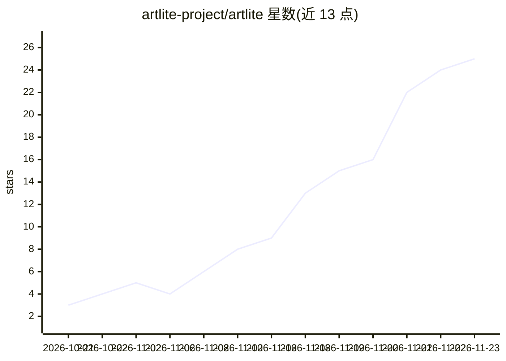

# artlite-project/artlite

⭐ 25 · Python · LGPL-2.1 · 推送 2026-11-22 · [GitHub](https://github.com/artlite-project/artlite) · 个人维护

**在 AMD Ryzen AI NPU 上运行 LLM 与图像生成的轻量推理运行时**

面向 AMD Strix Point/Krackan Point/Strix Halo 处理器的 XDNA 2 NPU 的本地推理运行时：小型 C++ 库直接对接 amdxdna 驱动（Windows 经 XRT），运行时从源码编译内核。直接读取 GGUF 权重无需转换，提供 artlite-cli、artlite-server（OpenAI 兼容 API 与 web 聊天）、artlite-bench 等工具，支持文本生成、语音转写/合成、多模态问答、嵌入与重排，并可作为编码 agent 的本地模型后端。支持 Linux 与 Windows 11，需 C++23 编译器、libdrm、CMake 与 uv。README 注明项目定位偏研究性质，decode 速度受 NPU 内存带宽限制。

## 筛选速览

| 维度 | 判定 | 备注 |
|---|---|---|
| AI 角色 | `ai-ecosystem` | LLM/agent 周边工具 |
| 许可风险 | `viral` | LGPL-2.1 |
| 部署形态 | `None` |  |
| 模型依赖 | local-ok | 支持本地模型 |
| 硬件要求 | — | 无带数字的原话,不猜 |
| 安装摩擦 | `low` | 无编译、无系统依赖或容器化 |
| 成熟度 | — | 结构信号不足 |

## 能力要点

- 直接运行 GGUF 文件，无需转换权重
- artlite-server 提供 OpenAI 兼容 API 及 llama.cpp 风格工具
- 支持 JSON schema/语法/工具调用的结构化输出
- 覆盖语音转写与合成、图像/视频多模态、嵌入与重排

## 适用场景

- 在 Ryzen AI 笔记本上本地运行 LLM 推理
- 为 Claude Code 等编码 agent 提供本地模型后端
- 在 NPU 上运行嵌入、重排等任务以省电并释放 GPU
- NPU 上的 Stable Diffusion 图像生成实验

## 场景标签

`推理引擎` `图像生成` `语音识别` `多模态` · 领域:内容生成

## 证据(README 行号)

> L11: Point and Strix Halo processors. Its runtime is a small C++ library that talks to the `amdxdna` driver directly, in
> L22: - **Tools in llama.cpp's style.** `artlite-cli`, `artlite-server` (an OpenAI-compatible API and llama.cpp's web cha
> L63: Requirements: a Ryzen AI processor with an XDNA 2 NPU, Linux with the `amdxdna` driver, libdrm, CMake, a C++23

## 星数曲线

2026-10-21 3 → 2026-11-23 25（+22）

---
*卡片 v1 · prompt 1.4 · 生成 2026-11-18 · 置信度 high · 依据 README sha `8cd8e0bc1efb` · [字段定义](../../DATASET.md)*
