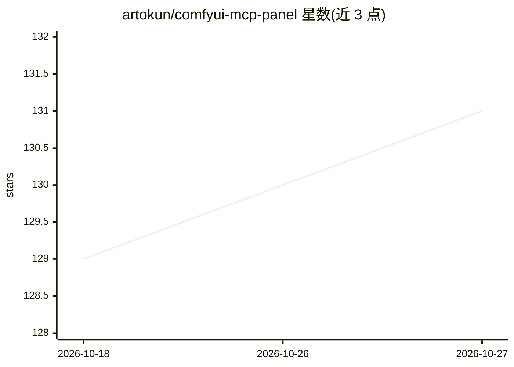

# artokun/comfyui-mcp-panel

⭐ 131 · JavaScript · MIT · 推送 2026-10-26 · [GitHub](https://github.com/artokun/comfyui-mcp-panel) · [官网](https://comfyui-mcp.artokun.io/docs/panel) · 个人维护

**嵌入 ComfyUI 侧边栏的本地 AI agent 面板，自然语言驱动画布**

comfyui-mcp 项目的面板 UI：作为 ComfyUI 自定义节点安装后在侧边栏提供 Agent 标签页，用户在 Claude（Claude CLI）或 ChatGPT（Codex CLI）中二选一，agent 通过后台 orchestrator（默认 ws://127.0.0.1:9199 回环端口）在用户自有订阅上运行，无需 API key。agent 经固定 panel_* 工具白名单（禁任意 JS）增删连线节点、改组件值、一键加载工作流、经用户自己的 ComfyUI-Manager 安装自定义节点并重启后续接任务；所有图编辑可用 Ctrl+Z 撤销。界面提供 12 种语言（含简/繁中文）。限制：维护有限恢复状态，将待 ComfyUI 官方面板公开后重估；README 记录 Codex 曾因工具预算静默丢弃画布工具（#291）。

## 筛选速览

| 维度 | 判定 | 备注 |
|---|---|---|
| AI 角色 | `ai-native` | 本体是模型或模型工具 |
| 许可风险 | `permissive` | MIT |
| 部署形态 | `library` | 以包/库形式分发 |
| 模型依赖 | locked-api |  |
| 硬件要求 | — | 无带数字的原话,不猜 |
| 安装摩擦 | `low` | 无编译、无系统依赖或容器化 |
| 成熟度 | — | 结构信号不足 |

## 能力要点

- Claude/ChatGPT 双后端选择，跑在用户自有订阅上，无需 API key
- 固定 panel_* 工具白名单驱动画布：加节点、连线、改组件、排版，全部可 Ctrl+Z 撤销
- 一键加载工作流/安装包，经用户自己的 ComfyUI-Manager 安装自定义节点并重启续接
- 付费 API 花费前检查运行时并先询问；对话与代码双轨回滚

## 适用场景

- 用自然语言在 ComfyUI 里搭图、改参数、装节点
- 把常用工作流转成一键运行的应用或可复用技能
- 在 Claude 与 ChatGPT 订阅之间切换驱动同一画布

## 场景标签

`AI 助手` `图像生成` · 领域:对话与助手

## 证据(README 行号)

> L16: **An autonomous AI agent embedded in the ComfyUI sidebar that drives your canvas — now on EITHER
> L34: Pick a provider — **Claude** or **ChatGPT** — and the matching agent runs in the background on
> L50: **No API keys. No extra LLM costs.** The agent runs on your Claude *or* ChatGPT

## 星数曲线

2026-10-18 129 → 2026-10-27 131（+2）

---
*卡片 v1 · prompt 1.4 · 生成 2026-10-22 · 置信度 mid · 依据 README sha `634c2190b017` · [字段定义](../../DATASET.md)*
