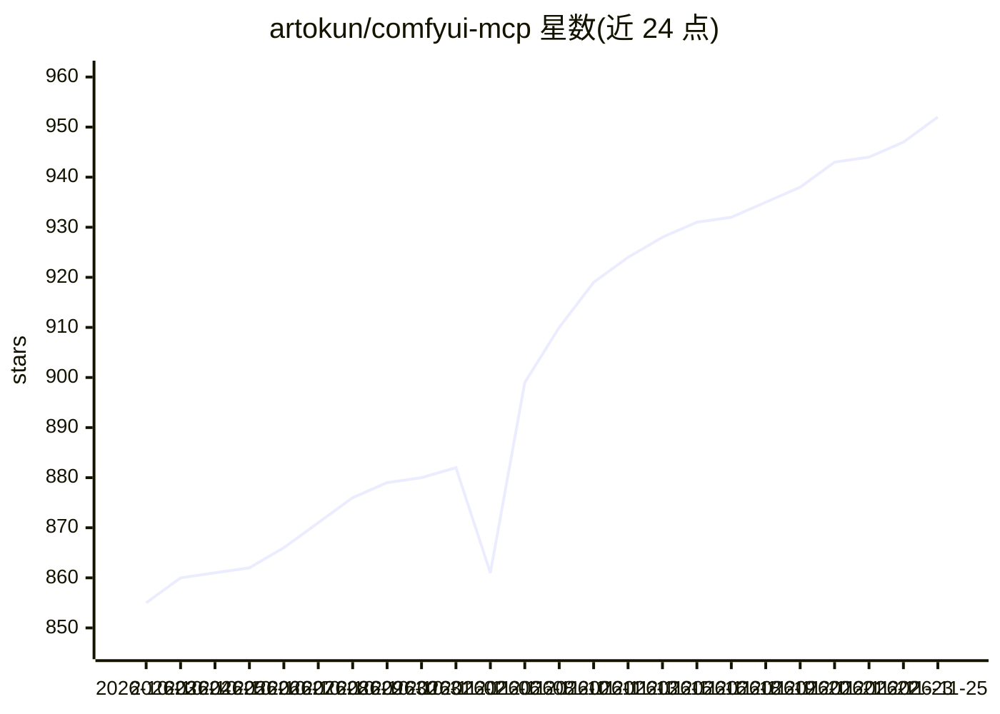

# artokun/comfyui-mcp

⭐ 952 · TypeScript · MIT · 推送 2026-11-23 · [GitHub](https://github.com/artokun/comfyui-mcp) · [官网](https://comfyui-mcp.artokun.io/docs) · 组织维护

**用任意 LLM 通过 MCP 驱动 ComfyUI 的本地控制平面**

一个 MCP server 与 ComfyUI 侧栏 agent 的组合：读取本地已装模型与节点、逐节点编写与编辑画布 graph、运行工作流并迭代生成图像/视频/音频，另提供模型与自定义节点管理、故障诊断和 42 个技能。支持 Claude 订阅、ChatGPT、Gemini、Ollama 本地模型及任一 OpenAI 兼容端点，同一套工具覆盖本地/局域网/VPS/Comfy Cloud 部署形态。以 npm 包分发，无需 clone 仓库，依赖已安装的 ComfyUI。

## 筛选速览

| 维度 | 判定 | 备注 |
|---|---|---|
| AI 角色 | `ai-ecosystem` | LLM/agent 周边工具 |
| 许可风险 | `permissive` | MIT |
| 部署形态 | `library` | 以包/库形式分发 |
| 模型依赖 | local-ok | 支持本地模型 |
| 硬件要求 | — | 无带数字的原话,不猜 |
| 安装摩擦 | `medium` | 含编译或系统依赖之一 |
| 成熟度 | — | 结构信号不足 |

## 能力要点

- 38 个 MCP 工具 + 4 个自治 agent + 3 个 hooks（VRAM watchdog、保存警告、任务完成通知）
- 42 个内置技能：Flux/WAN/LTX 等模型指南、模型注册表、Civitai、节点编写
- 自然语言编辑实时 ComfyUI graph，支持 rewind/rollback 与多标签
- 56 个一键安装包（installer packs），manifest 驱动并带 CI 校验

## 适用场景

- 用自然语言让 agent 搭建并执行 ComfyUI 图像生成工作流
- 在 RunPod/VPS 上远程驱动本地机器上的 agent 操作云端 ComfyUI
- 批量扫参生成并对比、可视化与 diff 工作流
- 诊断工作流失败原因并修复自定义节点问题

## 场景标签

`图像生成` `视频生成` · 领域:内容生成

## 证据(README 行号)

> L12: **The local-first, agent-native control plane for ComfyUI.** An MCP server plus a live sidebar agent that generates

## 星数曲线

2026-10-23 855 → 2026-11-25 952（+97）

---
*卡片 v1 · prompt 1.4 · 生成 2026-11-24 · 置信度 mid · 依据 README sha `af351d3025fa` · [字段定义](../../DATASET.md)*
