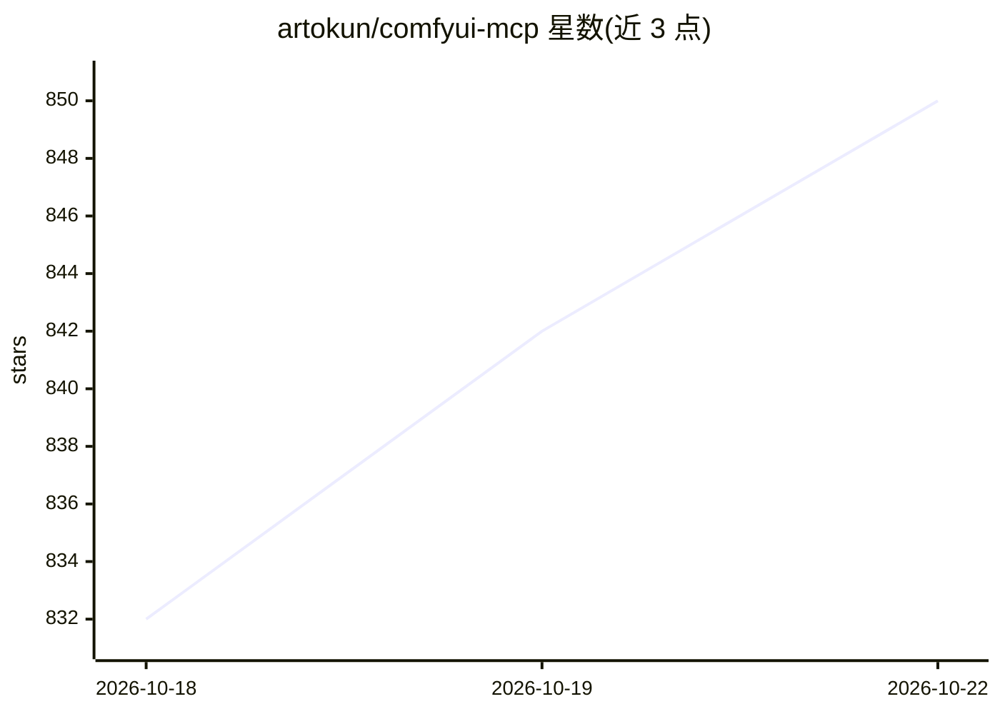

# artokun/comfyui-mcp

⭐ 850 · TypeScript · MIT · 推送 2026-10-19 · [GitHub](https://github.com/artokun/comfyui-mcp) · [官网](https://comfyui-mcp.artokun.io/docs) · 个人维护

**用任意 LLM 操控 ComfyUI 的 MCP 服务器与侧边栏 Agent**

面向 ComfyUI 用户的本地优先控制平面：包含 MCP 服务器与嵌入 ComfyUI 侧边栏的自主 Agent，可生成图像/视频/音频、编写并运行工作流、管理模型与自定义节点、以自然语言编辑实时计算图。支持 Claude、ChatGPT、Gemini、Ollama 本地模型及任意 OpenAI 兼容端点。附带 38 个 MCP 工具、42 个技能、13 个安装包、11 个斜杠命令、4 个自主 Agent 与 3 个钩子，可经 npx 免克隆运行。项目声明处于有限维护状态，仅修复关键问题。

## 筛选速览

| 维度 | 判定 | 备注 |
|---|---|---|
| AI 角色 | `ai-ecosystem` | LLM/agent 周边工具 |
| 许可风险 | `permissive` | MIT |
| 部署形态 | `library` | 以包/库形式分发 |
| 模型依赖 | local-ok | 支持本地模型 |
| 硬件要求 | — | 无带数字的原话,不猜 |
| 安装摩擦 | `medium` | 含编译或系统依赖之一 |
| 成熟度 | — | 结构信号不足 |

## 能力要点

- MCP 服务器 + 侧边栏 Agent，自然语言编辑实时 ComfyUI 图
- 支持任意 LLM：Claude/ChatGPT/Gemini/离线 Ollama/OpenAI 兼容端点
- npx 免克隆运行，可连接本地、LAN、VPS 或 Comfy Cloud
- 内置 42 个技能、13 个一键安装包与 4 个自主 Agent

## 适用场景

- 用对话驱动 ComfyUI 完成生成与工作流搭建
- 在无账号离线环境用本地模型操控 ComfyUI
- 从本机 Agent 操控 RunPod 等远程 ComfyUI 实例

## 场景标签

`图像生成` `视频生成` · 领域:内容生成

## 证据(README 行号)

> L20: **The local-first, agent-native control plane for ComfyUI.** An MCP server plus a live sidebar agent that generates
> L41: > An autonomous AI agent in your ComfyUI sidebar, running **on Claude, ChatGPT, Gemini, or ANY local/hosted LLM** (
> L73: **More than a bridge.** Most ComfyUI MCP servers are thin connectors. They forward a prompt and hand back an image.

## 星数曲线

2026-10-18 832 → 2026-10-22 850（+18）

---
*卡片 v1 · prompt 1.4 · 生成 2026-10-21 · 置信度 mid · 依据 README sha `a21996382e19` · [字段定义](../../DATASET.md)*
