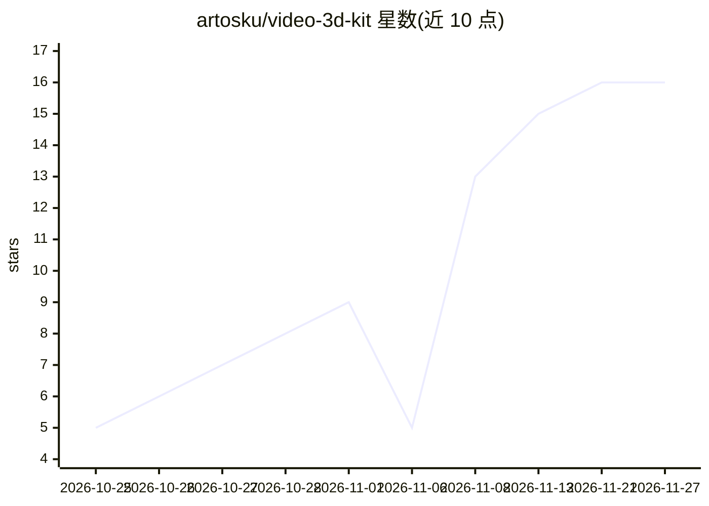

# artosku/video-3d-kit

⭐ 16 · Python · NOASSERTION · 推送 2026-11-12 · [GitHub](https://github.com/artosku/video-3d-kit) · 个人维护 · 中文 README

**给 AI agent 装上 /video-3d 命令，一句话生成双角色配音 3D 短视频**

面向 AI agent（Claude Code、Codex、Cursor、Gemini CLI 等）的工具包：用户把仓库链接发给 agent 并说 setup，agent 读取 AGENT_SETUP.md 将工具安装到 ~/.video-3d-kit 并创建斜杠命令。之后用一行 /video-3d <主题> 生成两个角色对话的配音 3D 短视频，或用 /video-3d-toons 让角色叠加在用户已有视频上讲解画面。语音来自 Cartesia 或 ElevenLabs（需账号与 API key），内置 3D 引擎、音效、角色与场景模板；支持竖屏/横屏/方形，可在无 GPU 环境运行。需要 Python 3.9+、Node.js、ffmpeg 与 Chrome。

## 筛选速览

| 维度 | 判定 | 备注 |
|---|---|---|
| AI 角色 | `ai-native` | 本体是模型或模型工具 |
| 许可风险 | `none` | NOASSERTION |
| 部署形态 | `None` |  |
| 模型依赖 | — | README 未给出锁定关系 |
| 硬件要求 | — | 无带数字的原话,不猜 |
| 安装摩擦 | `medium` | 含编译或系统依赖之一 |
| 成熟度 | — | 结构信号不足 |

## 能力要点

- 一行 /video-3d <主题> 生成带配音、字幕、配乐的双角色 3D 短视频
- /video-3d-toons 让角色叠加在已有视频上逐屏讲解
- 内置两个角色、夜间卧室等场景模板，可自建角色与场景
- 无需 GPU 即可渲染（有显卡时自动加速）

## 适用场景

- 制作 TikTok/Reels/Shorts/YouTube 竖屏或横屏解说短视频
- 给自己的录屏视频加上双角色逐句讲解
- 让 AI agent 一句话代为生成并导出成片

## 场景标签

`视频生成` `语音合成` · 领域:内容生成

## 证据(README 行号)

> L9: Short 3D videos where two characters talk, made by your AI agent from one line: `/video-3d <topic>`. And `/video-3d-
> L19: Paste this link to your AI agent (Claude Code, Codex, Cursor, Gemini CLI, ...) from any folder and say **"setup"**:
> L28: - Python 3.9+, Node.js, ffmpeg, Chrome (the agent checks these and tells you how to install what is missing).

## 星数曲线

2026-10-25 5 → 2026-11-27 16（+11）

---
*卡片 v1 · prompt 1.4 · 生成 2026-11-18 · 置信度 high · 依据 README sha `0eec76eb092c` · [字段定义](../../DATASET.md)*
