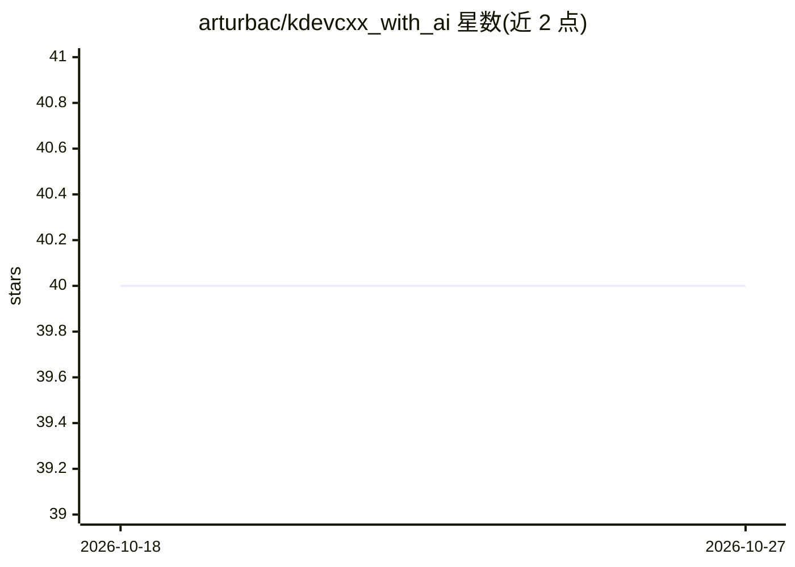

# arturbac/kdevcxx_with_ai

⭐ 40 · C++ · MIT · 推送 2026-10-03 · [GitHub](https://github.com/arturbac/kdevcxx_with_ai) · 个人维护

**KDevelop/Kate 的 C++ AI 编码辅助插件**

面向 KDevelop IDE 与 Kate 编辑器的插件，通过 OpenAI API 为 C++ 开发提供 AI 辅助：代码补全、文档查询、代码分析、错误修正建议与重构辅助。使用方式为在编辑器中书写 [AI ...] 前缀指令并选中目标代码，从下拉菜单触发 AI 处理；API key 与 C++ 规则在设置中配置，Kate 与 KDevelop 共享设置。需自行编译安装：依赖 CMake、Boost（≥1.66.0）、OpenSSL 与 KDE ECM（≥5.68.0），外部库由 CPM 自动管理，MIT 许可。

## 筛选速览

| 维度 | 判定 | 备注 |
|---|---|---|
| AI 角色 | `ai-native` | 本体是模型或模型工具 |
| 许可风险 | `permissive` | MIT |
| 部署形态 | `None` |  |
| 模型依赖 | — | README 未给出锁定关系 |
| 硬件要求 | — | 无带数字的原话,不猜 |
| 安装摩擦 | `medium` | 含编译或系统依赖之一 |
| 成熟度 | — | 结构信号不足 |

## 能力要点

- 通过 OpenAI API 提供代码补全/文档查询/分析/纠错/重构辅助
- [AI 指令] + 选中文本 + Process with AI 菜单的工作流
- 同时支持 KDevelop 插件与 Kate 插件，设置共享
- CPM 自动管理 simple_enum/glaze/fmt/ut 等外部依赖

## 适用场景

- 在 KDevelop/Kate 中直接请求 AI 生成或修改 C++ 代码
- 为 C++ 标准库函数做文档查询与错误修正
- 借助 AI 重构旧代码并按自定义规则生成单元测试

## 场景标签

`代码生成` · 领域:编码与开发

## 证据(README 行号)

> L3: KDevCXX with AI is an innovative extension for the KDevelop IDE and Kate Editor, focusing on integrating AI-powered 
> L7: - **AI-Powered Code Completion**: Utilizes a trained model `gpt-4-1106-preview` to suggest code completions, signifi

## 星数曲线

2026-10-18 40 → 2026-10-27 40（+0）

---
*卡片 v1 · prompt 1.4 · 生成 2026-10-25 · 置信度 high · 依据 README sha `aa53ec71d283` · [字段定义](../../DATASET.md)*
