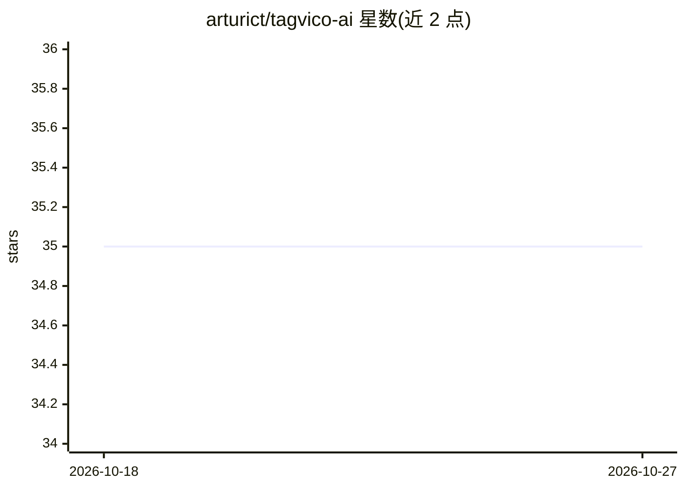

# arturict/tagvico-ai

⭐ 35 · TypeScript · MIT · 推送 2026-10-26 · [GitHub](https://github.com/arturict/tagvico-ai) · [官网](https://tagvico.arturf.ch/) · 个人维护

**Paperless-ngx 的自托管行动中心与审批门控 AI 伴侣**

部署在 Paperless-ngx 旁的单容器应用：把信件和 PDF 转成带负责人、期限、最多 100 步清单的行动案件，面向家庭多成员与角色分工。AI Companion 可读取许可文档并准备变更，但每次写入都需所有者或成年人审批，由确定性执行器落账并记录审计。可选的元数据归档工具轮询新文档、读取 OCR 文本后请求模型生成结构化归档建议，支持 Review first 或自动模式。模型侧通过 Vercel AI SDK 接入 OpenRouter、Ollama、OpenAI、ChatGPT 订阅等。部分 v2 功能已进入维护模式。

## 筛选速览

| 维度 | 判定 | 备注 |
|---|---|---|
| AI 角色 | `ai-native` | 本体是模型或模型工具 |
| 许可风险 | `permissive` | MIT |
| 部署形态 | `desktop` | 安装包/桌面程序 |
| 模型依赖 | local-ok | 支持本地模型 |
| 硬件要求 | — | 无带数字的原话,不猜 |
| 安装摩擦 | `low` | 无编译、无系统依赖或容器化 |
| 成熟度 | — | 结构信号不足 |

## 能力要点

- 文档→行动案件：负责人、期限、审计轨迹与最多 100 步清单
- 所有 Companion 写入均需审批，模型无 shell/文件系统工具
- 可选 AI 元数据归档：Review first 队列、恢复快照、成本感知模式
- 单容器 + SQLite + 持久卷，支持本地推理端点

## 适用场景

- 把家庭信件 PDF 转成待办并分派给家人跟进
- 在自托管环境给 Paperless 文档做需审批的 AI 自动打标归档
- 通过 Telegram/Discord 让家人查询、上传并审批提案

## 场景标签

`工作流自动化` · 领域:效率与自动化

## 证据(README 行号)

> L29: - **Chat first** — Tagvico opens on a chat with suggestions built from your real documents. Answers cite the Paperl
> L33: - **AI with approval boundaries** — the Companion can read permitted documents and prepare changes; only an owner o
> L184: The optional metadata filing utility works alongside this: when enabled, Tagvico polls Paperless-ngx for new docum

## 星数曲线

2026-10-18 35 → 2026-10-27 35（+0）

---
*卡片 v1 · prompt 1.4 · 生成 2026-10-25 · 置信度 mid · 依据 README sha `821b09272618` · [字段定义](../../DATASET.md)*
