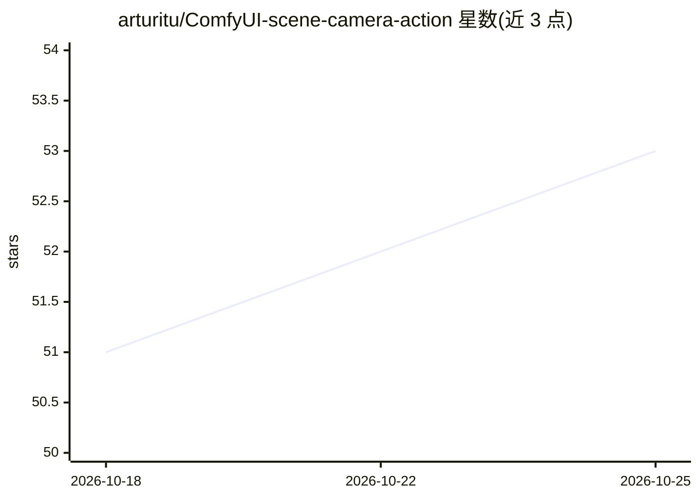

# arturitu/ComfyUI-scene-camera-action

⭐ 53 · JavaScript · 推送 2026-09-03 · [GitHub](https://github.com/arturitu/ComfyUI-scene-camera-action) · 个人维护

**ComfyUI 3D 预演节点套件：搭景、WASD 表演、运镜输出参考视频**

ComfyUI 自定义节点套件，把 AI 视频生成前的预演做成可玩的 3D 工作室：Staging 节点搭建可交互 3D 场景（含预设与 AI 提示建景的 SKILL.md），Acting 节点用 WASD 键盘实时驱动 Human/Car/Quadruped 三类角色并支持多角色串接，Directing 节点提供多种摄影机位、防穿墙 Spring Arm 与时间线剪辑，输出 720p 的 VIDEO 可直接接入 Seedance / MiniMax 等参考图生视频模型。面向使用 ComfyUI 的视频创作者，经 Manager、comfy-cli 或 git clone 安装，3D 视口运行于浏览器 WebGL。

## 筛选速览

| 维度 | 判定 | 备注 |
|---|---|---|
| AI 角色 | `ai-ecosystem` | LLM/agent 周边工具 |
| 许可风险 | `permissive` | — |
| 部署形态 | `desktop` | 安装包/桌面程序 |
| 模型依赖 | — | README 未给出锁定关系 |
| 硬件要求 | — | 无带数字的原话,不猜 |
| 安装摩擦 | `low` | 无编译、无系统依赖或容器化 |
| 成熟度 | — | 结构信号不足 |

## 能力要点

- Staging/Acting/Directing 三节点工作流，无 AI 模型也能跑纯 3D 预演
- WASD 实时操控与多角色串接、幽灵回放，无需关键帧
- 输出 720p VIDEO，接入 Seedance / MiniMax Reference-to-Video 模型
- SKILL.md 指令集让 AI 编码助手从自然语言生成 3D 场景 JSON 预设

## 适用场景

- 在生视频前用 3D 预演确定角色走位与镜头调度
- 把精确运动作为参考视频喂给生成式视频模型
- 用自然语言或参考图快速生成 3D 场景预设

## 场景标签

`视频生成` · 领域:内容生成

## 证据(README 行号)

> L8: *Interactive 3D scene staging, actor acting, and camera directing suite for **ComfyUI**.*
> L15: 3. **Directing:** Live camera cuts with anti-collision **Spring Arm**, outputting crisp 720p HD reference video (`V
> L85: - **Direct-to-Generative Output**: Outputs crisp 720p HD `Captured Video` (`VIDEO`) ready to plug into reference-to

## 星数曲线

2026-10-18 51 → 2026-10-25 53（+2）

---
*卡片 v1 · prompt 1.4 · 生成 2026-10-24 · 置信度 mid · 依据 README sha `7417232bd688` · [字段定义](../../DATASET.md)*
