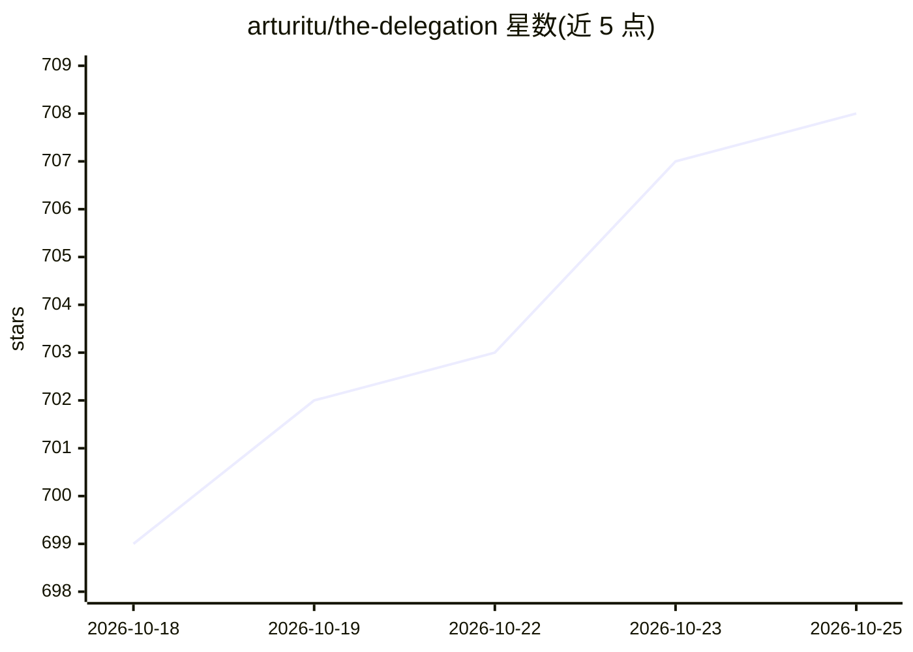

# arturitu/the-delegation

⭐ 710 · TypeScript · NOASSERTION · 推送 2026-04-16 · [GitHub](https://github.com/arturitu/the-delegation) · [官网](https://arturitu.github.io/the-delegation/) · 个人维护

**无代码 3D 游乐场：可视化探索与设计多智能体系统**

面向 AI 爱好者、教育者与创意开发者的无代码 3D 应用：在 Three.js WebGPU 构建的 3D 办公室中，自主 LLM 角色协作完成任务。提供 React Flow 节点式团队编辑器、6 套预置行业团队模板、逐 Agent 指定 Gemini 模型、PR 式工作流与人工审批、护栏与技术日志。多模态输出覆盖文本、图像（Nano Banana）、音乐（Lyria 3）与视频（Veo 3.1）。采用 BYOK 模式，需自备 Gemini API key，可在线体验或本地 npm 运行；项目采用双许可模式。

## 筛选速览

| 维度 | 判定 | 备注 |
|---|---|---|
| AI 角色 | `ai-native` | 本体是模型或模型工具 |
| 许可风险 | `none` | NOASSERTION |
| 部署形态 | `library` | 以包/库形式分发 |
| 模型依赖 | — | README 未给出锁定关系 |
| 硬件要求 | — | 无带数字的原话,不猜 |
| 安装摩擦 | `low` | 无编译、无系统依赖或容器化 |
| 成熟度 | — | 结构信号不足 |

## 能力要点

- 节点式团队编辑器创建多 Agent 设计模式
- 多模态生成：文本/图像/音乐/视频
- 逐 Agent 分配不同 Gemini 模型与成本 token 追踪
- PR 式工作流含 human-in-the-loop 审批与护栏

## 适用场景

- 不写代码直观理解多智能体协作机制
- 教学演示 Agent 团队分工与工作流
- 设计并运行创意机构、影视工作室等行业 Agent 模板

## 场景标签

`多智能体` · 领域:Agent 开发

## 证据(README 行号)

> L12: # A no-code 3D playground to explore, design, and interact with Agentic AI systems
> L38: - **Multimodal Outputs:** Generate professional assets including text, image (Nano Banana), music (Lyria 3), and vi

## 星数曲线

2026-10-18 699 → 2026-10-25 708（+9）

---
*卡片 v1 · prompt 1.4 · 生成 2026-10-21 · 置信度 high · 依据 README sha `404337c6db99` · [字段定义](../../DATASET.md)*
