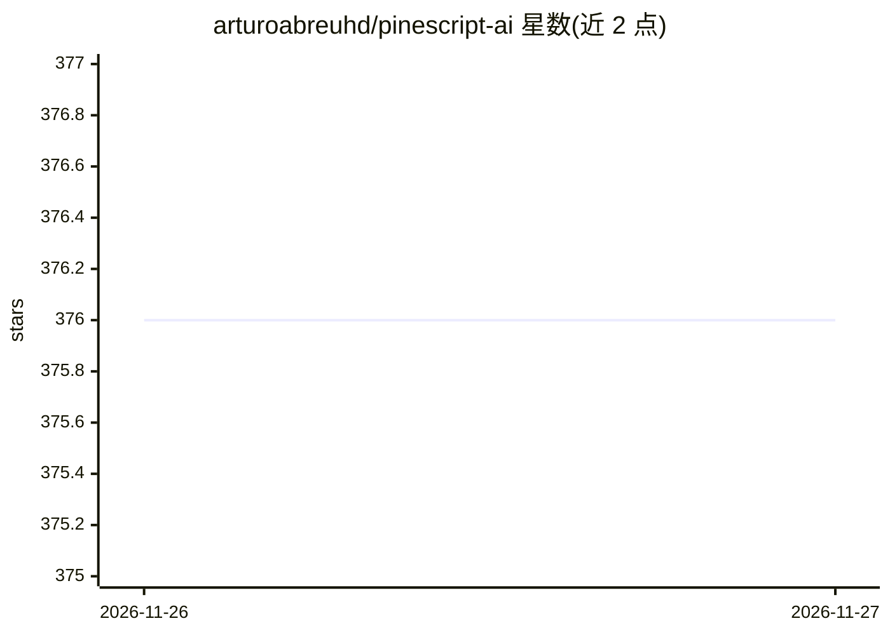

# arturoabreuhd/pinescript-ai

⭐ 376 · TypeScript · MIT · 推送 2026-11-25 · [GitHub](https://github.com/arturoabreuhd/pinescript-ai) · [官网](https://emergence.augmentedjudgment.com) · 个人维护

**自托管的 PineScript v6 代码生成器，RAG 检索文献与示例脚本**

基于 Next.js 的自托管 Web 应用：以 BM25 检索 PineScript v6 参考文档与 285 个示例脚本，将函数签名、文档块与完整脚本注入提示词后调用 LLM 生成代码，输出经静态正则、可选 AST 转译器与 AI 代码审查三层校验。BYOK 模式下 API key 仅存浏览器 localStorage。知识库可自行替换扩展，npm run build-rag 重建索引。维护者为个人，以 best-effort 方式维护，Issues 每周读取一次。

## 筛选速览

| 维度 | 判定 | 备注 |
|---|---|---|
| AI 角色 | `ai-native` | 本体是模型或模型工具 |
| 许可风险 | `permissive` | MIT |
| 部署形态 | `self-host` | docker 或自建部署 |
| 模型依赖 | local-ok | 支持本地模型 |
| 硬件要求 | — | 无带数字的原话,不猜 |
| 安装摩擦 | `low` | 无编译、无系统依赖或容器化 |
| 成熟度 | — | 结构信号不足 |

## 能力要点

- BM25 本地检索索引，无需向量数据库与 embeddings API
- 三层校验：正则规则、可选 pine-transpiler AST 检查、AI 审查自动修正
- 多 LLM 提供商支持且全部走 SSE 流式输出
- 知识库可替换，检索结果按 5 函数/3 文档/2 脚本注入

## 适用场景

- 为 TradingView 编写 PineScript v6 指标与策略脚本
- 自建知识库让 LLM 按自有文档与示例生成代码
- 本地运行、API key 不出浏览器的代码生成工具

## 场景标签

`代码生成` `金融量化` · 领域:编码与开发

## 证据(README 行号)

> L3: Self-hosted PineScript code generator with RAG-powered generation, multi-provider LLM support, and a built-in valida
> L8: - **RAG-powered generation** — BM25 search over PineScript v6 docs and 285 example scripts, injected into every prom
> L23: Open http://localhost:3000, pick your provider, paste your API key, and start generating.

## 星数曲线

2026-11-26 376 → 2026-11-27 376（+0）

---
*卡片 v1 · prompt 1.4 · 生成 2026-11-26 · 置信度 high · 依据 README sha `67adc3597aa3` · [字段定义](../../DATASET.md)*
